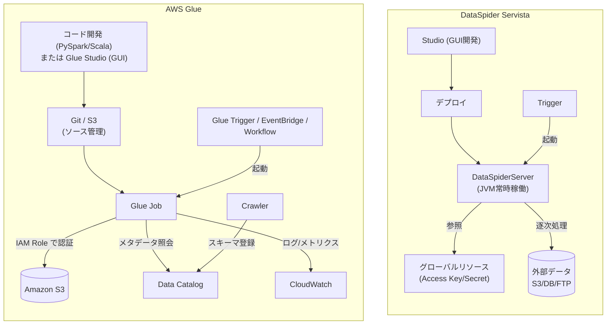
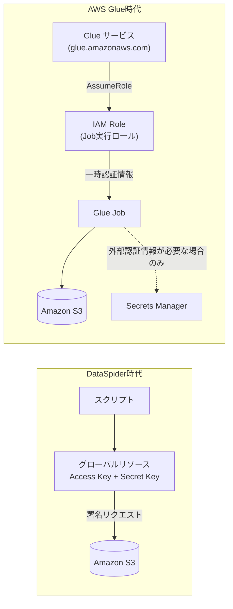
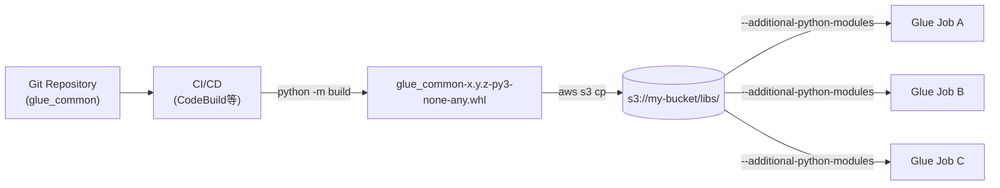

# DataSpiderからAWS Glueへの移植ガイド

DataSpider Servistaで構築されたETL資産をAWS Glueへ移植する際に、「不要になる機能」「大きく変わる機能(特にS3アクセス方式)」「共通処理のライブラリ化」を、初めてAWS Glueに触れる読者向けに整理したガイドです。

> **本ドキュメントの読み方**
>
> - 各記述の直後に出典URLを併記しています。
> - 「【事実】」「【解釈】」「【要確認】」のラベルで、公式ドキュメントで裏取り済みの記述と、調査者による解釈・注釈を区別しています。
> - サンプルコード・IAMポリシー・コマンドは最小構成を意識した例です。一部は抜粋(断片)のため、実運用ではリージョン・アカウント・バケット名・バージョン等を適宜置換・補完してください。

## 目次

1. [はじめに(移植の全体像)](#1-はじめに移植の全体像)
2. [AWS Glueの基礎(初学者向け)](#2-aws-glueの基礎初学者向け)
3. [DataSpider と AWS Glue の比較](#3-dataspider-と-aws-glue-の比較)
4. [移植で「不要になる」機能・概念](#4-移植で不要になる機能概念)
5. [移植で「大きく変わる」機能・概念](#5-移植で大きく変わる機能概念)
6. [共通処理のライブラリ化](#6-共通処理のライブラリ化)
7. [移植プロジェクトを進める上での注意点まとめ](#7-移植プロジェクトを進める上での注意点まとめ)
8. [補足: 用語集](#8-補足-用語集)
9. [参考リンク](#参考リンク)

---

## 1. はじめに(移植の全体像)

DataSpider ServistaはGUIベースでETLを組み上げるオンプレミス/クラウド対応の統合ミドルウェアで、Amazon S3をはじめ50種類以上のアダプタを持ちます([DataSpider製品ページ](https://www.saison-technology.com/service/product/lineup/dataspider/))。一方でAWS Glueは、サーバ管理不要でApache Spark(またはPython Shell)を実行する**サーバレスなデータ統合サービス**です([What is AWS Glue](https://docs.aws.amazon.com/glue/latest/dg/what-is-glue.html))。

両者は目的こそETLで共通ですが、思想が大きく異なります。移植プロジェクトでは、単純な機能マッピングではなく**「捨てるもの」「置き換えるもの」「新規に設計しなおすもの」**の3層に分解して整理することを推奨します。

```mermaid
flowchart LR
    subgraph AS_IS["現行 (DataSpider)"]
        DS_Studio["Studio (GUI)"]
        DS_Server["DataSpiderServer (JVM)"]
        DS_Trigger["Trigger"]
        DS_GR["グローバルリソース<br/>(Access Key/Secret)"]
    end

    subgraph TO_BE["移行後 (AWS Glue)"]
        Glue_Job["Glue Job (PySpark/Scala)"]
        Glue_Studio["Glue Studio<br/>(Visual editor)"]
        Glue_Trigger["Glue Trigger /<br/>EventBridge / Workflow"]
        IAM["IAM Role"]
        Catalog["Data Catalog"]
    end

    DS_Studio -->|コード資産へ再構成| Glue_Job
    DS_Studio -.->|GUI継続したい場合| Glue_Studio
    DS_Server -->|サーバレスへ| Glue_Job
    DS_Trigger -->|置換| Glue_Trigger
    DS_GR -->|置換(基本)| IAM
    DS_GR -.->|外部認証情報のみ| Catalog
```

## 2. AWS Glueの基礎(初学者向け)

### 2.1 AWS Glueとは

【事実】AWS Glueは、複数のデータソースからデータを「発見・準備・移動・統合」するための**サーバレスなデータ統合サービス**です。ETL(抽出・変換・ロード)パイプラインをビジュアルに作成・実行・監視でき、70以上のデータソースに接続し、メタデータを中央のData Catalogで一元管理できます。インフラ管理は不要で、ワークロードに応じて自動スケールし、従量課金(pay-as-you-go)で利用します([What is AWS Glue](https://docs.aws.amazon.com/glue/latest/dg/what-is-glue.html))。

> **補足: サーバレスとは**
> インスタンスやコンテナを利用者が事前に確保・管理する必要がなく、ジョブ実行時にAWS側が計算リソースを割り当てる方式です。料金は実行した時間・DPU数で従量課金され、待機コストが発生しません。DataSpiderServerの常時稼働との大きな差分となります。

### 2.2 主要コンポーネント

| コンポーネント | 役割 | DataSpider類似物 |
|---|---|---|
| **Glue Job** | ETL処理の実行単位。`glueetl`(Spark)/`gluestreaming`(Spark Streaming)/`pythonshell`(軽量Python)の3種類。SparkはPython/Scalaで記述 | スクリプト(サービス) |
| **Glue Crawler** | データソースをスキャンしスキーマを自動推論、Data Catalogへ登録 | 明示的な対応物なし(アダプタ側でスキーマ定義) |
| **Glue Data Catalog** | 全データの中央メタデータリポジトリ。Hiveメタストア互換 | 明示的な対応物なし |
| **Glue Studio** | ジョブをビジュアル(ノード配置)で作成・実行・監視するGUI | Studio(近い操作感) |
| **Trigger / Workflow** | Triggerはスケジュール/オンデマンド/イベント起動。Workflowは複数ジョブ・Crawlerを連鎖 | Trigger |
| **Glue DataBrew** | コードを書かずにデータクレンジング・正規化するビジュアルツール | 一部の変換系アイコン |

(出典: [What is AWS Glue](https://docs.aws.amazon.com/glue/latest/dg/what-is-glue.html), [Job properties](https://docs.aws.amazon.com/glue/latest/dg/add-job.html), [AWS Glue concepts](https://docs.aws.amazon.com/glue/latest/dg/components-key-concepts.html))

> **【事実】AWS Glue for Ray**: Rayエンジン(`glueray`)も提供されていましたが、**2026年4月30日をもって新規顧客の受付を終了**しています。既存顧客は引き続き利用可能ですが、セキュリティ・可用性以外の新機能追加は予定されておらず、代替としてAmazon EKS(KubeRay)が推奨されています。新規採用は避けてください([AWS Glue for Ray end of support](https://docs.aws.amazon.com/glue/latest/dg/awsglue-ray-jobs-availability-change.html))。

### 2.3 Glue Version

【事実】Glue VersionによってSpark/Python/Scala/Javaのバージョンが決まります。

| Version | Spark | Python | Scala | Java |
|---|---|---|---|---|
| Glue 4.0 | 3.3.0 | 3.10 | 2.12 | 8 |
| Glue 5.0 | 3.5.4 | 3.11 | 2.12.18 | 17 |
| Glue 5.1 | 3.5.6 | 3.11 | 2.12.18 | 17(【要確認】) |
| Glue 6.0 | 4.1.1 | 3.13 | 2.13 | 17 |

(出典: [Job properties (add-job)](https://docs.aws.amazon.com/glue/latest/dg/add-job.html), [Introducing AWS Glue 6.0 for Apache Spark](https://aws.amazon.com/blogs/big-data/introducing-aws-glue-6-0-for-apache-spark/)。Glue 5.1のJavaバージョンは今回参照した公式ページでは明記を確認できず)

- 【事実】**Glue 5.0**(2024年12月GA)は4.0比で約32%高速・コスト22%削減の実測が公式ブログで報告されています。SageMaker Unified Studio連携、requirements.txt依存管理、Lake Formationによるきめ細かなアクセス制御、S3 Tables対応、データリネージ(DataZone連携)、テーブルフォーマット更新(Hudi 0.15.0 / Iceberg 1.7.1 / Delta Lake 3.3.0)を追加([Introducing AWS Glue 5.0 for Apache Spark](https://aws.amazon.com/blogs/big-data/introducing-aws-glue-5-0-for-apache-spark/))。※パフォーマンス数値(32%/22%)は原典ブログの記載を引用しており、公開前に最新値を原典で最終確認することを推奨します。
- 【事実】**Glue 5.1**が2025年11月26日にGAとなり、**Spark 3.5.6 / Python 3.11 / Scala 2.12.18**を搭載します([What's New: AWS Glue 5.1](https://aws.amazon.com/about-aws/whats-new/2025/11/aws-glue-5-1/))。
- 【事実】**Glue 6.0**が2026年8月21日にGAとなり、**Spark 4.1.1 / Python 3.13 / Scala 2.13 / Java 17**を搭載します。Glue 6.0で実行するジョブは5.1比で**DPU単価が30%引き下げ**られ、Apache Iceberg v3(Iceberg 1.11.0)、Hudi 1.1.1、Delta Lake 4.2.0に対応します([What's New: AWS Glue 6.0](https://aws.amazon.com/about-aws/whats-new/2026/08/aws-glue-6-0-price-reduction-iceberg-v3/), [Introducing AWS Glue 6.0 for Apache Spark](https://aws.amazon.com/blogs/big-data/introducing-aws-glue-6-0-for-apache-spark/))。Spark 3系→4系のメジャーアップデートのため、既存ジョブの移行時は互換性検証が必要です(公式ブログではSpark Upgrade Agentの利用が案内されています)。
- 【事実】バージョンを指定せずに作成したジョブは**Glue 5.1がデフォルト**です(「Jobs that are created without specifying a AWS Glue version default to AWS Glue 5.1.」/[Job properties (add-job)](https://docs.aws.amazon.com/glue/latest/dg/add-job.html))。最新の6.0を使う場合は明示的に指定してください。
- 【解釈】これから移植する新規ジョブは、Spark 4系への追従コストと30%の単価削減を比較したうえで、**Glue 6.0を第一候補**とするのが合理的です。
- 【事実】Glue 2.0以前は**2026年4月1日でEnd of Life(実行不可)**となっています([AWS Glue version support policy](https://docs.aws.amazon.com/glue/latest/dg/glue-version-support-policy.html))。

### 2.4 料金体系(DPU中心)

【事実】課金の中心は **DPU(Data Processing Unit)** です。**1 DPU = 4 vCPU + 16 GBメモリ**。ETLジョブ・Crawler・Interactive Sessionは秒単位課金(**最低課金1分**)です([AWS Glue pricing](https://aws.amazon.com/glue/pricing/))。

- ETLジョブ / Crawler: **$0.44 / DPU-hour**(例: 6 DPUで15分 ≒ $0.66)
- Flex実行: **$0.29 / DPU-hour**
- 【事実】Glue 6.0で実行するジョブは5.1比で30%の値下げが公式に発表されています([Introducing AWS Glue 6.0 for Apache Spark](https://aws.amazon.com/blogs/big-data/introducing-aws-glue-6-0-for-apache-spark/))。【要確認】6.0の具体的な単価は、今回参照時点のpricingページの取得内容では確認できなかったため、見積もり前に[公式pricingページ](https://aws.amazon.com/glue/pricing/)で確認してください。
- Data Catalog: 月100万オブジェクト・100万リクエストまで無料、超過は10万オブジェクトあたり$1.00/月
- DataBrew: Interactive Session $1.00/30分、ジョブ $0.48/node-hour

ワーカータイプ(1ワーカーあたりのDPU、出典: [Job properties (add-job)](https://docs.aws.amazon.com/glue/latest/dg/add-job.html)):

| Type | DPU | vCPU | メモリ | 用途 |
|---|---|---|---|---|
| G.025X | 0.25 | 2 | 4 GB | 低容量ストリーミング(Glue 3.0+) |
| G.1X | 1 | 4 | 16 GB | 汎用(推奨デフォルト) |
| G.2X | 2 | 8 | 32 GB | 汎用・大きめ |
| G.4X | 4 | 16 | 64 GB | 重い変換/集計/結合(Glue 3.0+) |
| G.8X | 8 | 32 | 128 GB | 最も要求の高いワークロード(Glue 3.0+) |

【事実補足】さらに大規模向けのG.12X/G.16X、メモリ最適化R.1X〜R.8X(いずれもGlue 4.0以降のSpark ETLジョブ、一部リージョン限定、起動レイテンシが大きい)もあります。**Flex実行**(非緊急ジョブ向けの割安クラス、Glue 3.0以降、G.1X/G.2Xのみ。G.12X/G.16X/R系は非対応)も提供されています。単価はリージョン差・改定があるため、最新情報を[公式pricingページ](https://aws.amazon.com/glue/pricing/)で必ず確認してください。

### 2.5 向いているケース・向いていないケース

- 【事実ベース】**向いている**: S3データレイクへのETL/ELT、多数のソースの統合とカタログ化、サーバレスで運用負荷を下げたい大規模バッチ・ストリーミング、Athena/Redshift Spectrum等との連携前処理。
- 【解釈】**不向き・要検討**: ミリ秒級の低レイテンシAPI/OLTP、極小データを常時処理するケース(起動オーバーヘッドやDPUの最小課金が割高)、Spark/Python以外のランタイム前提の処理、リアルタイム双方向トランザクション。この節は公式明示ではなく調査者の解釈です。

---

## 3. DataSpider と AWS Glue の比較

### 3.1 DataSpider Servistaのアーキテクチャ

DataSpiderは大きく3層で構成されます([DataSpider製品ページ](https://www.saison-technology.com/service/product/lineup/dataspider/), [サービスの基礎知識](https://www.hulft.com/help/ja-jp/DataSpider/dss43/help/ja/servista/service_basic.html))。

- **Studio(開発ツール)**: スクリプトを設計するGUIデザイナ。処理アイコンのドラッグ&ドロップだけでデータ連携を組む「ノンプログラミング」開発環境。
- **Server(実行基盤)**: DataSpiderServerがスクリプトを実行する。公式ヘルプではスクリプトは「ソースコードに変換されます」と説明されている。【要確認】変換先の言語(Java等)や内部のコンパイル方式は、今回参照した公式ヘルプでは明記を確認できなかった。
- **Trigger**: スケジュール/ファイル/HTTP/DB/FTP/Webサービス/Amazon Kinesis/SAP など多彩なイベントでサービス(スクリプト)を起動([トリガー](https://www.hulft.com/help/ja-jp/DataSpider/dss42sp3/help/ja/trigger/trigger.html))。※このリンクのみDataSpider Servista 4.2 SP3のヘルプで、他の参照(4.3)とバージョンが異なる。移植元のバージョンのヘルプで最終確認すること。

その他、外部システム接続部品としての**アダプタ(コネクタ)**、GUIワークフローとしての**スクリプト**、接続先情報を一元管理する**グローバルリソース**([グローバルリソース](https://www.hulft.com/help/ja-jp/DataSpider/dss43/help/ja/servista/global_resource.html))といった概念があります。

### 3.2 コンポーネント対応表

| 観点 | DataSpider Servista | AWS Glue |
|---|---|---|
| 開発方式 | GUIドラッグ&ドロップ(Studio、ノンプログラミング) | コード(PySpark/Scala) + Glue Studio でGUI作成も可能(生成コードは編集可) |
| 実行基盤 | 自前のDataSpiderServer(常時稼働のJVMプロセス) | **サーバレス**(管理インフラなし、Apache Spark、**DPU/Worker**課金) |
| スケジューリング | Trigger(スケジュール/ファイル/HTTP/DB 等) | **Glue Trigger**(スケジュール/オンデマンド/イベント)、**Workflow**、EventBridge |
| 監視・ログ | DataSpiderのログ/運用ツール | **CloudWatch Logs/Metrics**、Job run insights、Spark UI、CloudTrail |
| 接続情報管理 | **グローバルリソース** | **Connection**(Data Catalogオブジェクト) + 認証情報は**Secrets Manager**連携 |
| エラーハンドリング | 例外処理コンポーネント | スクリプト内の`try/except` + Job定義の`MaxRetries`(Job再試行) |
| 増分処理 | 【要確認】スクリプト側で処理済み管理を実装 | **Job bookmarks**(処理済みソースの状態管理) |
| メタデータ/スキーマ | アダプタ単位でスキーマ定義 | **Data Catalog** + **Crawler**による自動スキーマ推論 |

(出典: Glue全般 [What is AWS Glue](https://docs.aws.amazon.com/glue/latest/dg/what-is-glue.html), 用語 [AWS Glue concepts](https://docs.aws.amazon.com/glue/latest/dg/components-key-concepts.html))

### 3.3 アーキテクチャ比較(図解)



---

## 4. 移植で「不要になる」機能・概念

サーバレスであるため、**サーバ管理・JVMチューニング・OSやミドルウェアの保守**が不要になります(Glueは「no infrastructure to manage」/「pay-as-you-go」/[What is AWS Glue](https://docs.aws.amazon.com/glue/latest/dg/what-is-glue.html))。ワーカーは負荷に応じて自動スケールするため、実行基盤のサイジングも大幅に軽減されます。

具体的に「捨てて良いもの」は以下です。

- **DataSpiderServerのプロビジョニング・OS/JVMパッチ適用・キャパシティプランニング**
- **JVMヒープ・GCチューニング**
- **DataSpiderServerライセンス管理**(Glueは従量課金モデル。※DataSpider側の具体的なライセンス形態は今回調査した公式製品ページでは確認できず、【要確認】)
- **アクセスキー/シークレットのグローバルリソース登録**(基本はIAM Roleに置換。詳細は5.2)
- **「ダウンロード→ローカル一時ファイル→加工→アップロード」型の中間ファイル管理**(GlueはSparkによるS3直読み・直書きが基本)
- **アイコン単位のリトライ設定**(Sparkのタスク再試行 + boto3リトライ + Job再試行に集約)

---

## 5. 移植で「大きく変わる」機能・概念

### 5.1 GUI開発 → コード開発

Glue StudioでGUIジョブも作れますが、実体は**PySpark/Scalaコード**であり、Studio上でも生成コードは編集可能です([AWS Glue concepts](https://docs.aws.amazon.com/glue/latest/dg/components-key-concepts.html))。DataSpiderのアイコン結線に慣れた開発者は、コードをGitで管理する開発体制、ユニットテスト、CI/CDパイプラインを新規に整備する必要があります。

### 5.2 S3アクセス方式(重点セクション)

#### 5.2.1 DataSpider側のS3アクセス方式

DataSpider Servista(および DataSpider Cloud)には **Amazon S3アダプタ**が用意されており、GUI上の処理アイコンをドラッグ&ドロップしてS3と連携します。

- **認証情報の管理**: 接続情報は**グローバルリソース**に集約する。コントロールパネルから「Cloud > Amazon S3」を選び、**Access Key ID**と**Secret Access Key**(IAMユーザーの認証情報)、および接続先**Endpoint**(例: `s3-ap-southeast-1.amazonaws.com`)を設定する。通信はHTTPS。スクリプト側はこのグローバルリソースを参照するため、キーをスクリプトに直書きしない設計になっている([HULFT FAQ 35507](https://faq2.hulft.com/faq/show/35507), [DataSpider Cloud Help: Amazon S3 データ書き込み](https://doc.dataspidercloud.com/v1/help/ja/adapter/cloud/amazons3_put_data.html))。【要確認】DataSpiderServerをEC2上で稼働させている場合などに、S3アダプタがIAM Role(インスタンスプロファイル/AssumeRole)による認証に対応しているかは、今回参照した公式情報では確認できなかった。移植元環境の実際の設定を棚卸しすること。
- **典型的な操作**: ファイルの**アップロード/ダウンロード**、**データ書き込み/データ読み込み**、**ファイル一覧取得**、**ファイル削除**に相当する操作が提供される。※各アイコンの正式名称の完全な一覧は今回参照した公式ヘルプ上では確認できず、【要確認】。移植時は実スクリプトのアイコン名を現物で確認してください。
- **典型フロー**: 「S3からローカル一時領域へダウンロード → マッピング/変換アイコンで加工 → S3へアップロード」という**一度ローカルに落とす**構成になりがち。

#### 5.2.2 AWS Glue側のS3アクセス方式(複数ある点が重要)

Glueには単一の「S3コンポーネント」はなく、**用途に応じて複数のAPIを使い分けます**。

| 方式 | 主な用途 | 特徴 |
|---|---|---|
| **DynamicFrame経由**(Glueネイティブ) | 大規模ETLの読み書き | スキーマ揺れ、Job bookmarks、大量小ファイルのグルーピング(`groupFiles`)に強い |
| **Spark DataFrame経由** | 標準的な大規模ETL | Sparkの一般的API。Glue外(EMR等)への移植性が高い |
| **boto3経由** | 単発のファイル操作、メタデータ取得、存在確認、削除 | DataFrameを介さない制御系処理向け |
| **awswrangler(AWS SDK for pandas)** | 小規模ファイルの読み書き | pandas風APIで手軽。**Glue for Sparkの同梱モジュールには含まれない**ため`--additional-python-modules`等で追加が必要 |

(出典: [Amazon S3 connections in AWS Glue](https://docs.aws.amazon.com/glue/latest/dg/aws-glue-programming-etl-connect-s3-home.html), [Connecting to data in ETL scripts](https://docs.aws.amazon.com/glue/latest/dg/aws-glue-programming-etl-connect.html)。awswranglerの同梱有無は[Python libraries](https://docs.aws.amazon.com/glue/latest/dg/aws-glue-programming-python-libraries.html)の「Python modules already provided in AWS Glue」で確認。boto3/awswranglerの使い分けは【解釈】)

> **補足(groupFiles)**: 入力ファイルが50,000件を超えるとファイルのグルーピングは自動で有効になります。50,000件未満でグルーピングしたい場合は`"groupFiles": "inPartition"`を明示します([Amazon S3 connections](https://docs.aws.amazon.com/glue/latest/dg/aws-glue-programming-etl-connect-s3-home.html))。

#### 5.2.3 `s3://` vs `s3a://` vs `s3n://`

【事実】Glueの公式ドキュメント・サンプルは一貫して**`s3://`スキーム**を用いています([Amazon S3 connections](https://docs.aws.amazon.com/glue/latest/dg/aws-glue-programming-etl-connect-s3-home.html))。【解釈】`s3a://`(Hadoop S3A実装)や`s3n://`(Hadoop 3で削除された旧実装)は避けるべきで、スキームを混在させると暗号化設定の扱いなどで挙動が食い違うケースが技術ブログで報告されています。

> **【要確認】出典について**: `s3a`の非推奨扱いを明記したAWS公式単独のページは今回確認できず、技術ブログ([Tiny caveats of using different S3 Schemes on AWS Glue](https://datachef.co/blog/tiny-caveats-of-using-different-s3-schemes-on-aws-glue/))を出典としています。厳密なポリシーはプロジェクト内で必ず`s3://`に統一する運用ルールを敷くのが安全です。

#### 5.2.4 認証方式の変化(最重要)

- **DataSpider時代**: Access Key / Secret Key をグローバルリソースに保存し、それを参照。
- **Glue時代**: **Jobに紐づく IAM Role**が基本。Glueサービス(`glue.amazonaws.com`)がこのRoleを引き受け、ジョブには一時的な認証情報が渡されます。Glue Job実行時、コード内でキーを一切指定しなくても、割り当てられたIAM Roleの認証情報が自動で使われます。Access Keyの直書きは**アンチパターン**です([Setting up IAM permissions for AWS Glue](https://docs.aws.amazon.com/glue/latest/dg/getting-started-access.html))。
- 別アカウントや外部サービスの認証情報が必要な場合は、**AWS Secrets Manager**に格納し、実行時に取得します。キーをスクリプトや環境変数に平文で置かないでください。



#### 5.2.5 具体コード例: S3上のCSVを読みParquetで書き出す最小Glue Job

```python
import sys
from awsglue.utils import getResolvedOptions
from pyspark.context import SparkContext
from awsglue.context import GlueContext
from awsglue.job import Job

args = getResolvedOptions(sys.argv, ["JOB_NAME"])
sc = SparkContext()
glueContext = GlueContext(sc)
job = Job(glueContext)
job.init(args["JOB_NAME"], args)

dyf = glueContext.create_dynamic_frame.from_options(
    connection_type="s3",
    connection_options={"paths": ["s3://my-input-bucket/csv/"], "recurse": True},
    format="csv",
    format_options={"withHeader": True},
    transformation_ctx="source_csv",
)

glueContext.write_dynamic_frame.from_options(
    frame=dyf,
    connection_type="s3",
    connection_options={"path": "s3://my-output-bucket/parquet/"},
    format="parquet",
    transformation_ctx="sink_parquet",
)
job.commit()
```

(API出典: [Amazon S3 connections / DynamicFrame from_options](https://docs.aws.amazon.com/glue/latest/dg/aws-glue-programming-etl-connect-s3-home.html))

> **補足**: `transformation_ctx`はJob bookmarksの状態を識別するキーです。省略するとbookmarkを有効化(`--job-bookmark-option job-bookmark-enable`)しても増分処理が効きません。また、bookmark有効のまま入力パスを変える場合は`transformation_ctx`も変えないと、新パスのファイルが処理済み扱いでスキップされる恐れがあります([Job bookmarks](https://docs.aws.amazon.com/glue/latest/dg/monitor-continuations.html))。

#### 5.2.6 IAM Roleに付与する最小権限(サンプルJSON)

```json
{
  "Version": "2012-10-17",
  "Statement": [
    {
      "Sid": "ReadInput",
      "Effect": "Allow",
      "Action": ["s3:GetObject", "s3:ListBucket"],
      "Resource": [
        "arn:aws:s3:::my-input-bucket",
        "arn:aws:s3:::my-input-bucket/*"
      ]
    },
    {
      "Sid": "WriteOutput",
      "Effect": "Allow",
      "Action": ["s3:GetObject", "s3:PutObject", "s3:DeleteObject", "s3:ListBucket"],
      "Resource": [
        "arn:aws:s3:::my-output-bucket",
        "arn:aws:s3:::my-output-bucket/*"
      ]
    }
  ]
}
```

【解釈】Sparkの書き込みでは出力先の存在確認や一時ファイルの操作が行われるため、出力バケットにも`s3:ListBucket`/`s3:GetObject`を付与しています。最小権限に絞る場合は実際にジョブを実行して確認してください。

上記に加えて、実行ロールには次の設定が必要です。

- **Trust policy**: Glueサービスがロールを引き受けられるようにする。

```json
{
  "Version": "2012-10-17",
  "Statement": [
    {
      "Effect": "Allow",
      "Principal": { "Service": "glue.amazonaws.com" },
      "Action": "sts:AssumeRole"
    }
  ]
}
```

- **AWS管理ポリシー`AWSGlueServiceRole`**: Glueリソースの操作やCloudWatch Logsへの出力に必要な権限を含む([Setting up IAM permissions for AWS Glue](https://docs.aws.amazon.com/glue/latest/dg/getting-started-access.html))。
- **スクリプト・TempDirのバケット**: ジョブスクリプトの配置先と`--TempDir`に指定したS3パスへの読み書き権限。【要確認】`AWSGlueServiceRole`がカバーするのは命名規則に合致するバケット(`aws-glue-*`等)に限られるため、独自のバケット名を使う場合は個別に付与すること。
- **`iam:PassRole`**: ジョブを作成・更新する側(開発者やCI/CDのロール)には、この実行ロールに対する`iam:PassRole`権限が必要です。

#### 5.2.7 S3アクセスに関するアンチパターン

- `boto3.client('s3', aws_access_key_id=..., aws_secret_access_key=...)` のような**キー直書き**(IAM Roleを使う)
- 大量ファイルを**1件ずつboto3でループ処理**(DynamicFrame/DataFrameで一括読み込み + `groupFiles`)
- **パーティション設計を無視した全件スキャン**(`year=/month=/`等のpartition pushdownを使わずコスト増)
- パスの**文字列連結ミス**で`s3://` が `s3//` や `s3:/` になる事故(末尾スラッシュ・区切りに注意)

### 5.3 スケジューリング/監視

- **スケジューリング**: DataSpiderのTriggerは、Glue Trigger(スケジュール/オンデマンド/イベント)や、より柔軟なEventBridge、複数ジョブを連鎖させるWorkflowに置き換わります。cron表記に近い記述が可能です。
- **監視・ログ**: DataSpiderのログや運用ツールは、CloudWatch Logs/Metrics、Job run insights、Spark UI、CloudTrailに分散します。Sparkジョブは特にSpark UIによる**ステージ・タスク単位の実行時間分析**が強力です。

### 5.4 エラーハンドリングとリトライの考え方

- DataSpiderのアイコン単位のリトライは、Glueでは3層に分散します。
  1. **Sparkのタスク自動再試行**: 個別タスクの失敗に対応(Spark設定)
  2. **boto3のリトライ設定**: `Config(retries={"max_attempts": 10, "mode": "standard"})`など、S3等の一時的なエラー
  3. **GlueのJob再試行回数**: Job定義の`MaxRetries`(0〜10)で全体再実行。タイムアウトで停止したジョブは再試行されない
- 【事実】**Jobタイムアウトのデフォルトに注意**: 未指定の場合、Glue 4.0以前は2,880分ですが、**Glue 5.0以降は480分(8時間)**です。最大は7日(10,080分)です([Job properties (add-job)](https://docs.aws.amazon.com/glue/latest/dg/add-job.html))。DataSpiderで長時間動いていたバッチをそのまま移すと途中で停止するため、想定実行時間に合わせて明示的に設定してください。
- **Job bookmarks**は「処理済みデータの状態」を保持し再処理を防ぐ機能ですが、追跡するのは**ソースのみ(ターゲットは非追跡)**で、`job.commit()`時に状態確定します。S3ソースは最終更新時刻で判定します([Job bookmarks](https://docs.aws.amazon.com/glue/latest/dg/monitor-continuations.html))。DBの厳密なトランザクション境界とは別物である点に注意してください。

---

## 6. 共通処理のライブラリ化

複数のGlue Jobで共通処理を再利用するときは、**共通コードを成果物(wheel / zip / JAR)としてS3に配置し、Job parameter経由で各Jobに配布する**のが基本方針です。

### 6.1 全体像



### 6.2 主なJob Parameter

| Parameter | 用途 | 対応形式 | 備考 |
|---|---|---|---|
| `--extra-py-files` | 自作Pythonコードの配布 | 単一`.py`、`.zip`(S3パス、カンマ区切り、空白なし) | **個別ファイルのみ**。ディレクトリ指定不可 |
| `--additional-python-modules` | pipで解決するパッケージ | PyPI名`==版`、S3上の`.whl`、`requirements.txt`(Glue 5.0+)、zip of wheels(Glue 5.0+) | Glue 2.0以降でpip3利用 |
| `--python-modules-installer-option` | pip3への追加オプション | 例: `--no-index`, `-r`, `--only-binary` | Python 3.9では非対応 |
| `--python-virtual-env` | 事前にビルドしたPython venv(`.tar.gz`)でジョブを実行 | S3パス | **Glue 5.0以降**。`--additional-python-modules`と併用不可。ベース環境のモジュールは引き継がれない |
| `--python-virtual-env-storage-prefix` | Glueが`--additional-python-modules`からvenvを自動生成しS3にキャッシュ | S3プレフィックス | **Glue 6.0以降**。キャッシュ破棄は`--python-virtual-env-version`をインクリメント |
| `--extra-jars` | JAR/リソースをdriver・executorへ配布しclasspath追加 | S3パス(カンマ区切り、拡張子`.jar`不問) | Scala/Java共通化に使用 |
| `--extra-files` | 設定ファイル等を作業ディレクトリへコピー | S3パス(ファイル/ディレクトリ) | Python Shellでは非対応 |
| `--user-jars-first` | 自作JARをclasspath優先 | `true` | Glue 2.0以降 |
| `--class` | Scalaエントリポイント | クラス名 | `--job-language scala`時のみ |

(出典: [Special parameters used by AWS Glue](https://docs.aws.amazon.com/glue/latest/dg/aws-glue-programming-etl-glue-arguments.html), [Providing your own custom Python libraries](https://docs.aws.amazon.com/glue/latest/dg/aws-glue-programming-python-libraries.html))

> **使い分けの目安**:
>
> - 【事実】**Glue 5.0以降では、Python virtual environment(venv)でジョブを実行するのが公式の推奨方式**です。Glue 6.0では`--python-virtual-env-storage-prefix`を追加するだけで、既存の`--additional-python-modules`の値からGlueがvenvを生成・キャッシュします(ローカルビルド不要)。Glue 5.0/5.1では自前でビルドしたvenvを`--python-virtual-env`で指定します([Python libraries](https://docs.aws.amazon.com/glue/latest/dg/aws-glue-programming-python-libraries.html))。
> - 【事実】`--additional-python-modules`を使う場合、公式は「利用可能なら`--additional-python-modules`で依存を管理する」としており、本番では**全依存をzip of wheelsにまとめる**ことを推奨しています。自作の共通ライブラリはwheel化してここに含めます。
> - 【事実】`--extra-py-files`は、パッケージ化していないコードや、既存のSparkツールチェーンから移行する場合に使います。
> - 【事実】Glue 6.0の公式ブログによれば、`--additional-python-modules`を使う既存ジョブは6.0上で自動的にvenvへ変換されるため、追加対応は不要とされています([Introducing AWS Glue 6.0 for Apache Spark](https://aws.amazon.com/blogs/big-data/introducing-aws-glue-6-0-for-apache-spark/))。

### 6.3 Glue Version毎のPython/プラットフォーム差(重要)

| Glue版 | Python | Base image | glibc | 互換 platform tag |
|---|---|---|---|---|
| 6.0 | 3.13 | Amazon Linux 2023 | 2.34 | `manylinux_2_34_x86_64` / `manylinux_2_28_x86_64` / `manylinux2014_x86_64` |
| 5.1 / 5.0 | 3.11 | Amazon Linux 2023 | 2.34 | `manylinux_2_34_x86_64` / `manylinux_2_28_x86_64` / `manylinux2014_x86_64` |
| 4.0 | 3.10 | Amazon Linux 2 | 2.26 | `manylinux2014_x86_64` |
| 3.0 | 3.7 | Amazon Linux 2 | 2.26 | `manylinux2014_x86_64` |

※Glue 2.0は2026年4月1日でEnd of Lifeとなり実行できないため、表から除外しています([AWS Glue version support policy](https://docs.aws.amazon.com/glue/latest/dg/glue-version-support-policy.html))。

wheelのビルドは**ターゲットGlue版のPython/プラットフォームに合わせる**必要があります。ネイティブ拡張(numpy/pandas等のCコンパイル済み依存)を含むパッケージが環境不一致だと実行時エラーになります(出典: [Python libraries](https://docs.aws.amazon.com/glue/latest/dg/aws-glue-programming-python-libraries.html) Appendix B)。

> なお、`--additional-python-modules`での**zip of wheels**と**requirements.txt**指定は**Glue 5.0以降のみ**の機能です。

### 6.4 wheelパッケージ化の実践(最小構成)

`pyproject.toml`(標準Pythonツールチェーン。Glue固有ではありません):

```toml
[build-system]
requires = ["setuptools>=61", "wheel"]
build-backend = "setuptools.build_meta"

[project]
name = "glue_common"
version = "0.1.0"
requires-python = ">=3.11"
```

ディレクトリ構造は`glue_common/__init__.py`をパッケージ直下に置きます(`.zip`利用時もroot直下 + `__init__.py`必須。出典: [Python libraries](https://docs.aws.amazon.com/glue/latest/dg/aws-glue-programming-python-libraries.html) 「Zipping libraries」)。

ビルドとS3配置(`build`パッケージが未導入なら`pip install build`で導入):

```bash
python -m build
aws s3 cp dist/glue_common-0.1.0-py3-none-any.whl s3://my-bucket/libs/
```

Job Parameter:

```
--additional-python-modules s3://my-bucket/libs/glue_common-0.1.0-py3-none-any.whl
```

### 6.5 `--additional-python-modules`の本番構成: zip of wheels(Glue 5.0+)

全依存を`pip3 download`で取得し`.gluewheels.zip`にまとめてS3に配置、`--no-index`と併用することで、**実行時にPyPIへアクセスせず決定論的にインストール**できます。`--additional-python-modules`を本番で使う場合に公式が推奨する方式です(Glue 5.0以降の第一推奨はvenv。6.2節参照)。ビルドはGlue環境相当のAmazon Linux 2023コンテナ内で実施します。

```bash
# Glue 5.0 / 5.1 (Python 3.11) の例。Glue 6.0 は --python-version 313 とする
pip3 download -r requirements.txt --dest wheels/ \
  --platform manylinux2014_x86_64 --python-version 311 --only-binary=:all:
zip -r mylibraries-1.0.0.gluewheels.zip wheels/
```

```
--additional-python-modules s3://my-bucket/libs/mylibraries-1.0.0.gluewheels.zip
--python-modules-installer-option --no-index
```

(出典: [Python libraries](https://docs.aws.amazon.com/glue/latest/dg/aws-glue-programming-python-libraries.html) Appendix A)

### 6.6 利用側コード例

```python
# glue_common/transforms.py (共通処理)
def normalize_columns(df):
    return df.toDF(*[c.lower() for c in df.columns])
```

```python
# Job本体(抜粋。dyf は 5.2.5 節で読み込んだ DynamicFrame)
from glue_common.transforms import normalize_columns

df = normalize_columns(dyf.toDF())
```

Job Parameterの指定例(boto3でJobを登録する場合):

```python
import boto3

glue = boto3.client("glue")
glue.create_job(
    Name="sample-job",
    Role="arn:aws:iam::123456789012:role/GlueJobRole",
    GlueVersion="5.1",
    WorkerType="G.1X",
    NumberOfWorkers=2,
    Command={
        "Name": "glueetl",
        "ScriptLocation": "s3://my-bucket/scripts/sample_job.py",
        "PythonVersion": "3",
    },
    DefaultArguments={
        "--additional-python-modules": "s3://my-bucket/libs/glue_common-0.1.0-py3-none-any.whl",
    },
)
# start_job_run の Arguments で Run 毎に上書きも可能
```

(出典: [Using job parameters in AWS Glue jobs](https://docs.aws.amazon.com/glue/latest/dg/aws-glue-programming-etl-glue-arguments.html), [Python libraries](https://docs.aws.amazon.com/glue/latest/dg/aws-glue-programming-python-libraries.html))

### 6.7 Git統合とCI/CD

Glue Studioは**GitHub / AWS CodeCommit / GitLab / Bitbucket**の4プロバイダに対応します([Configuring Git for Glue Studio](https://docs.aws.amazon.com/glue/latest/dg/edit-job-add-source-control-integration.html))。JobのVersion Controlタブでリポジトリ・ブランチ・フォルダを指定してpush/pullします。API: `UpdateJobFromSourceControl` / `UpdateSourceControlFromJob`。

> **【事実】制限事項**: 「AWS Glue currently does not support pushing/pulling from GitLab-Groups.」と公式に明記されています。また、Git連携の対象はジョブスクリプトとビジュアルジョブで、Notebookは対象外です([Configuring Git for Glue Studio](https://docs.aws.amazon.com/glue/latest/dg/edit-job-add-source-control-integration.html))。

CI/CDフロー例(共通ライブラリのビルド→配置→Job更新):

1. リポジトリへpush → CodeBuild等で`python -m build`を実行
2. 生成されたwheel/zipを`aws s3 cp`でS3へ配置(バージョン付きパス)
3. 現在のJob定義を取得し、`--additional-python-modules`だけを新バージョンに差し替えて`aws glue update-job`で更新

> **⚠ 注意: `update-job`は定義を丸ごと上書きする**
>
> 【事実】UpdateJob APIは「The previous job definition is completely overwritten by this information.」という仕様です([UpdateJob API](https://docs.aws.amazon.com/glue/latest/webapi/API_UpdateJob.html))。`DefaultArguments`だけを渡すと、Role・ワーカー設定・他のJob Parameterなど指定しなかった項目が失われます。必ず`get-job`で現在の定義を取得し、差分をマージしてから渡してください。【解釈】Job定義自体をCloudFormation/CDK/Terraform等のIaCで管理し、CI/CDからはIaCの更新として反映する方式にすると、この事故を構造的に防げます。

```bash
# 例: 現在の定義を取得し、--additional-python-modules のみ差し替えて更新(jq使用)
# ※ get-job の出力には UpdateJob で受け付けない読み取り専用項目が含まれるため除外する
aws glue get-job --job-name sample-job --query 'Job' > job.json
jq 'del(.Name, .CreatedOn, .LastModifiedOn, .AllocatedCapacity, .MaxCapacity)
    | .DefaultArguments["--additional-python-modules"] = "s3://my-bucket/libs/glue_common-0.2.0-py3-none-any.whl"' \
  job.json > job-update.json
aws glue update-job --job-name sample-job --job-update file://job-update.json
```

【要確認】`get-job`の出力に含まれる項目のうち`JobUpdate`で受け付けないものは、Glueのバージョンやジョブ種別により異なる場合があります。初回はステージング環境で実行して確認してください。

AWS公式にはCodePipelineでGlue Jobをデプロイするパターンが公開されています([Deploy an AWS Glue job with an AWS CodePipeline CI/CD pipeline](https://docs.aws.amazon.com/prescriptive-guidance/latest/patterns/deploy-an-aws-glue-job-with-an-aws-codepipeline-ci-cd-pipeline.html))。※このパターンは主にJobデプロイの流れを示すもので、wheelビルドの詳細手順自体は別途一般的なPythonツールチェーンに従います。

### 6.8 Scala / Java(Spark)側の共通化

自作のScala/JavaコードはJARにまとめてS3に配置し、`--extra-jars`でclasspathへ追加、`--class`でエントリポイントを指定、必要に応じ`--user-jars-first=true`でGlue同梱JARより優先させます([Special parameters](https://docs.aws.amazon.com/glue/latest/dg/aws-glue-programming-etl-glue-arguments.html))。

> **【要確認】**: `sbt-assembly` / Maven shade plugin による fat JARビルドの手順は、AWS Glue公式ドキュメントでは扱っていません。これらは一般的なSparkビルドツールの機能で、Glueとしては「S3上のJARを`--extra-jars`で読む」ところまでが公式範囲です。

### 6.9 設計上のベストプラクティス

- **バージョニング**: 成果物にセマンティックバージョニング(例: `glue_common-0.1.0-...whl`)を付け、**S3パスにバージョンを含める**。Job側は明示的にバージョン指定して固定する。
- **依存の固定**: Glue 5.0以降は**venvでの実行**が公式の第一推奨です。`--additional-python-modules`を使う場合は、全ライブラリの版をpinし、さらに**zip of wheelsで凍結(frozen artifact)**することが推奨されています。`requirements.txt`での実行時PyPI解決は、pipの依存解決が完全に決定論的でないため本番では高リスクです。未pinの推移的依存が非互換版を引き込む点も警告されています([Python libraries](https://docs.aws.amazon.com/glue/latest/dg/aws-glue-programming-python-libraries.html))。
- **事前検証**: AWS公式の[`glue_python_dependency_analyzer`](https://github.com/aws-samples/aws-glue-samples/tree/master/utilities/glue_python_dependency_analyzer)で、ターゲットGlue環境に対する未pin依存・版衝突をデプロイ前に検出できます。
- **テスト戦略**: ローカルで`pytest`によりライブラリ単体をテスト → **Glue Interactive Sessions / Studio Notebook**で実環境相当の統合検証を行う([Interactive Sessions](https://docs.aws.amazon.com/glue/latest/dg/interactive-sessions.html))。
- 環境依存値(Data Catalogの接続情報、バケット名等)はライブラリに埋め込まず、**Job Parameter経由で注入**する(`getResolvedOptions`で取得)。

### 6.10 共通ライブラリ化のアンチパターン

- 各Jobにコードをコピペで運用する(修正が全Jobに波及し乖離の温床になる)
- 巨大な単一ライブラリに全処理を詰め込む(不要依存の肥大化・起動遅延)
- `--additional-python-modules`にネイティブ依存(numpy/pandas等)を無邪気に指定 → Glue環境のPython版/platform tag不一致でインストール失敗。対策はターゲット版でビルドしたwheel/zip of wheelsの利用
- Glue Version変更時にライブラリ側のPythonバージョンとズレる(例: Glue 4.0=Python 3.10 → Glue 5.0=Python 3.11、Glue 5.1=Python 3.11 → Glue 6.0=Python 3.13 でwheelタグ非互換)。版更新時はwheel再ビルド必須
- CI/CDから`aws glue update-job`に変更したい項目だけを渡す(UpdateJobは定義を丸ごと上書きするため、他の設定が消える。6.7節参照)
- 自作wheelを`--extra-py-files`に渡す(`--extra-py-files`の対象は`.py`/`.zip`。wheelは`--additional-python-modules`で指定する)
- 未pin依存で実行時にPyPIから最新版を引き、破壊的変更を取り込む
- 接続情報・バケット名・環境識別子などの環境依存値をライブラリ内にハードコード

---

## 7. 移植プロジェクトを進める上での注意点まとめ

1. **単純な機能マッピングではなく、思想の違いを踏まえた再設計を**: GUI逐次処理から分散処理(Spark)への移行なので、パーティション設計・スキーマ設計から見直す。
2. **S3の認証は必ずIAM Roleへ**: Access Keyの直書きはアンチパターン。移植と同時にセキュリティ姿勢が改善する好機と捉える。
3. **共通処理は最初からwheel化する**: 初回はコピペで済んでも、Jobが5〜10本を超えると保守コストが跳ね上がる。CI/CDと合わせて設計する。
4. **Glue Versionを明示して固定する**: 未指定だとGlue 5.1がデフォルトになる。新規ジョブはGlue 6.0(単価30%減、Spark 4.1)を第一候補に検討する。Version変更時は依存wheelの再ビルドが必要なので、Version昇格は計画的に。
5. **Jobタイムアウトを明示する**: Glue 5.0以降のデフォルトは480分。長時間バッチは途中で停止する。
6. **ローカル一時ファイル前提のロジックは書き換える**: DataFrame/DynamicFrameでS3を直接扱う。
7. **移植前にDataSpider側の実装(処理アイコン、グローバルリソース、トリガー)を棚卸しする**: 本ドキュメントの記載は公式ヘルプ準拠だが、アイコン名の完全一覧などは実物確認が確実。
8. **Job bookmarksの挙動を必ず理解する**: DBトランザクションとは別物。ソースのみ追跡でターゲットは非追跡。`transformation_ctx`の指定が必須。
9. **Job定義の更新はIaCまたはマージ更新で行う**: `update-job`の部分指定は他の設定を消す。

---

## 8. 補足: 用語集

| 用語 | 説明 |
|---|---|
| **DPU (Data Processing Unit)** | Glueの課金単位。1 DPU = 4 vCPU + 16 GBメモリ。 |
| **DynamicFrame** | Glue独自のデータフレーム抽象。スキーマ揺れに強く、DataFrameへ相互変換可能。 |
| **Job bookmarks** | 処理済みデータの状態を保持し、次回実行時に増分処理を実現する機能。 |
| **Data Catalog** | メタデータ(データベース・テーブル・スキーマ)を管理する中央リポジトリ。Hiveメタストア互換。 |
| **Crawler** | データソースをスキャンし、スキーマを推論してData Catalogに登録するコンポーネント。 |
| **Interactive Sessions** | Glueが提供するNotebook風の対話実行環境。開発・検証用。 |
| **wheel (`.whl`)** | Pythonパッケージのビルド済み配布形式。 |
| **manylinux** | LinuxディストリビューションをまたいだPythonネイティブwheelの互換タグ規約。 |
| **venv (Python virtual environment)** | 依存パッケージを隔離したPython実行環境。Glue 5.0以降でジョブ実行環境として推奨。 |
| **グローバルリソース (DataSpider)** | DataSpiderの接続情報一元管理機構。 |

---

## 参考リンク

### AWS Glue公式

- [What is AWS Glue](https://docs.aws.amazon.com/glue/latest/dg/what-is-glue.html)
- [AWS Glue concepts](https://docs.aws.amazon.com/glue/latest/dg/components-key-concepts.html)
- [Job properties (add-job)](https://docs.aws.amazon.com/glue/latest/dg/add-job.html)
- [Amazon S3 connections](https://docs.aws.amazon.com/glue/latest/dg/aws-glue-programming-etl-connect-s3-home.html)
- [Connecting to data in ETL scripts](https://docs.aws.amazon.com/glue/latest/dg/aws-glue-programming-etl-connect.html)
- [Data format options](https://docs.aws.amazon.com/glue/latest/dg/aws-glue-programming-etl-format.html)
- [Setting up IAM permissions for AWS Glue](https://docs.aws.amazon.com/glue/latest/dg/getting-started-access.html)
- [Special parameters used by AWS Glue (Job parameters)](https://docs.aws.amazon.com/glue/latest/dg/aws-glue-programming-etl-glue-arguments.html)
- [Providing your own custom Python libraries](https://docs.aws.amazon.com/glue/latest/dg/aws-glue-programming-python-libraries.html)
- [Configuring Git integration in AWS Glue Studio](https://docs.aws.amazon.com/glue/latest/dg/edit-job-add-source-control-integration.html)
- [Interactive Sessions](https://docs.aws.amazon.com/glue/latest/dg/interactive-sessions.html)
- [Job bookmarks](https://docs.aws.amazon.com/glue/latest/dg/monitor-continuations.html)
- [AWS Glue version support policy](https://docs.aws.amazon.com/glue/latest/dg/glue-version-support-policy.html)
- [AWS Glue for Ray end of support](https://docs.aws.amazon.com/glue/latest/dg/awsglue-ray-jobs-availability-change.html)
- [UpdateJob API Reference](https://docs.aws.amazon.com/glue/latest/webapi/API_UpdateJob.html)
- [AWS Glue pricing](https://aws.amazon.com/glue/pricing/)
- [Introducing AWS Glue 5.0 for Apache Spark (公式ブログ)](https://aws.amazon.com/blogs/big-data/introducing-aws-glue-5-0-for-apache-spark/)
- [What's New: AWS Glue 5.1](https://aws.amazon.com/about-aws/whats-new/2025/11/aws-glue-5-1/)
- [What's New: AWS Glue 6.0](https://aws.amazon.com/about-aws/whats-new/2026/08/aws-glue-6-0-price-reduction-iceberg-v3/)
- [Introducing AWS Glue 6.0 for Apache Spark (公式ブログ)](https://aws.amazon.com/blogs/big-data/introducing-aws-glue-6-0-for-apache-spark/)
- [Deploy an AWS Glue job with an AWS CodePipeline CI/CD pipeline (Prescriptive Guidance)](https://docs.aws.amazon.com/prescriptive-guidance/latest/patterns/deploy-an-aws-glue-job-with-an-aws-codepipeline-ci-cd-pipeline.html)
- [aws-glue-samples: glue_python_dependency_analyzer](https://github.com/aws-samples/aws-glue-samples/tree/master/utilities/glue_python_dependency_analyzer)

### DataSpider公式

- [DataSpider Servista 製品ページ (セゾンテクノロジー)](https://www.saison-technology.com/service/product/lineup/dataspider/)
- [DataSpider Servista ヘルプ: サービスの基礎知識](https://www.hulft.com/help/ja-jp/DataSpider/dss43/help/ja/servista/service_basic.html)
- [DataSpider Servista ヘルプ: グローバルリソース](https://www.hulft.com/help/ja-jp/DataSpider/dss43/help/ja/servista/global_resource.html)
- [DataSpider Servista ヘルプ: トリガー](https://www.hulft.com/help/ja-jp/DataSpider/dss42sp3/help/ja/trigger/trigger.html)
- [HULFT FAQ 35507 (Amazon S3アダプタ グローバルリソース設定)](https://faq2.hulft.com/faq/show/35507)
- [DataSpider Cloud Help: Amazon S3 データ書き込み](https://doc.dataspidercloud.com/v1/help/ja/adapter/cloud/amazons3_put_data.html)

### 参考ブログ

- [Tiny caveats of using different S3 Schemes on AWS Glue (DataChef)](https://datachef.co/blog/tiny-caveats-of-using-different-s3-schemes-on-aws-glue/)

---

最終更新日: 2026/10/09
