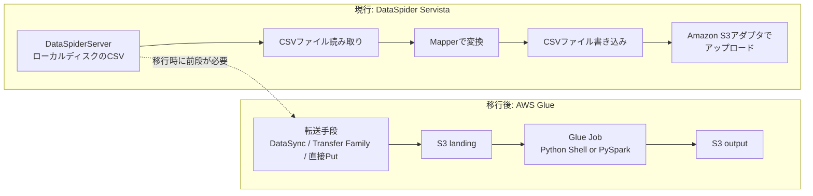
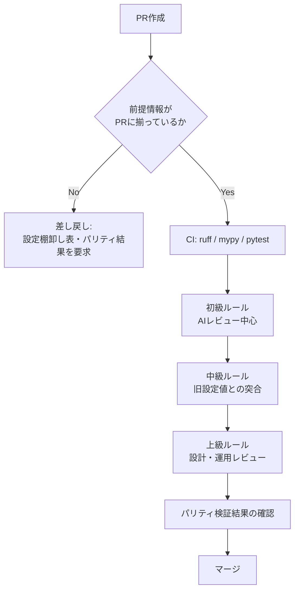
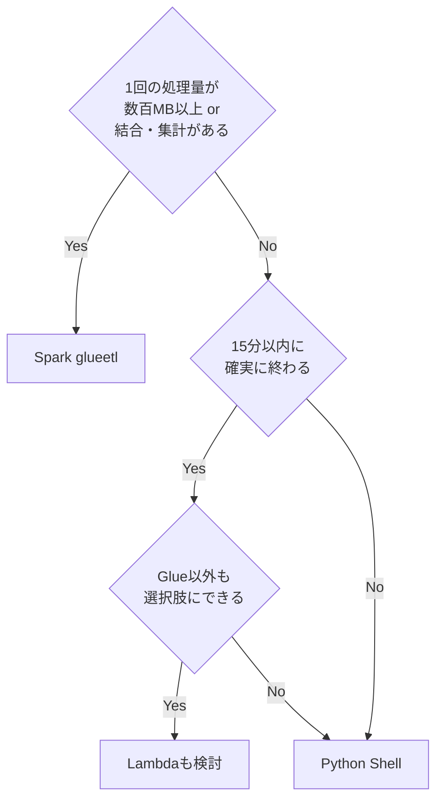
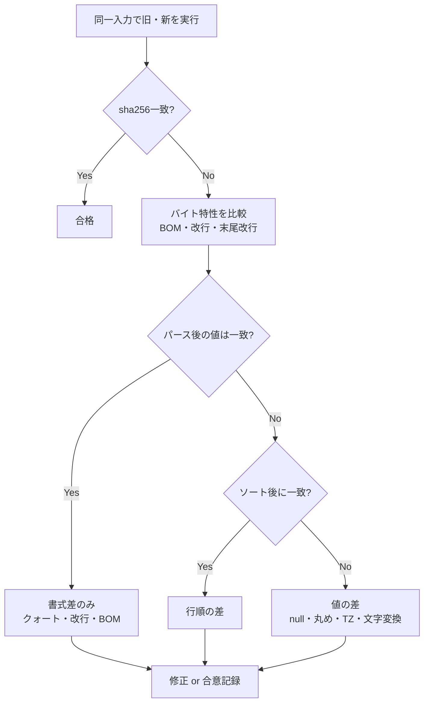

# DataSpider → AWS Glue (Python) 移行コード レビューガイドライン

DataSpider Servista で構築された「ファイル取得 → 内容変換 → 新しいファイルを作成 → Amazon S3 へアップロード」というCSV連携処理を、AWS Glue (Python) へ移行する際のコードレビュー基準です。初心者がやりがちなミスから、設計・運用レベルの上級観点までをレベル別に整理しています。

本ガイドは単体で読めるように構成しています。各ルールはID・レベル・重大度・検出条件・NG/OK例・出典を持ち、人間のレビュアーとAIレビュー(Claude Code等)の双方が同じ基準で指摘できる形式にしています。AIレビュー向けに要点だけを抜き出した版は [dataspider-to-glue-review-guideline.ai.md](./dataspider-to-glue-review-guideline.ai.md) にあります。

> **本ドキュメントの読み方**
>
> - 「【事実】」は公式ドキュメント等で裏取りした記述、「【検証】」は調査チームがローカル環境でコードを実行して挙動を確認した記述、「【解釈】」は調査者の推論・提言、「【要確認】」は公式情報で確認できなかった事項です。
> - 各ルールの出典はルール内に記載し、末尾の[参考リンク](#参考リンク)にもまとめています。
> - ローカル検証は Python 3.14 / pandas 3.0.6・2.3.3 / PySpark 3.5.6 で実施しました。Glue実機では実行していないため、Glue固有の挙動は公式ドキュメントの記述を根拠としています。

## 目次

1. [前提と背景](#1-前提と背景)
2. [レベルと重大度の定義](#2-レベルと重大度の定義)
3. [レビューの進め方](#3-レビューの進め方)
4. [ルール一覧(サマリ)](#4-ルール一覧サマリ)
5. [初級ルール: 初心者がやりがちなミス](#5-初級ルール-初心者がやりがちなミス)
6. [中級ルール: 旧仕様を知らないと見落とすミス](#6-中級ルール-旧仕様を知らないと見落とすミス)
7. [上級ルール: 設計・運用・堅牢性](#7-上級ルール-設計運用堅牢性)
8. [移行パリティ検証](#8-移行パリティ検証)
9. [AIレビューでの使い方](#9-aiレビューでの使い方)
10. [【要確認】事項一覧](#10-要確認事項一覧)
11. [参考リンク](#参考リンク)

---

## 1. 前提と背景

### 1.1 対象とする処理



- 想定する入力CSVは Shift_JIS系(CP932) と UTF-8 が混在します。
- Glue のジョブタイプは Python Shell と PySpark (`glueetl`) の両方を対象とします。選定基準は [ARCH-001](#arch-001-ジョブタイプの選定理由が記録されている) を参照してください。
- 現行の変換元ファイルは DataSpiderServer のローカルディスク上にあります。【事実】Glue のジョブ実行環境では、一時的な保存先として約 14 GiB の `/tmp` が使えます ([Python shell jobs](https://docs.aws.amazon.com/glue/latest/dg/add-job-python.html))。【解釈】実行環境はマネージドであり、オンプレミスのディスクをマウントする仕組みは公式ドキュメントに見当たりません。そのため、S3へファイルを持ち込む前段の設計が必須です ([ARCH-002](#arch-002-取得元からs3への転送方式と完了判定が設計されている))。

### 1.2 なぜ専用のレビューガイドラインが必要か

DataSpider は GUI のプロパティ設定とアダプタの既定値によって、多くの処理を**暗黙的に**行っています。Python に移植すると、それらはすべてコードで明示しなければなりません。移行事故の大半は「DataSpider では何も設定しなくてもそう動いていた」部分で起きます。

| DataSpiderが暗黙的に担っていたこと | Python/Glueで起きること |
|---|---|
| CSVのエンコード・改行コード・クォート規則 (アダプタの既定値) | 指定しなければ、Python・pandas・Spark それぞれの既定値になる (第6章) |
| 例外監視・終了ステータス・トランザクション | 自分で書かなければ、失敗が成功扱いになったり、中途半端なファイルが出力されたりする |
| null・空文字の扱い、スクリプト変数の型デフォルト値 | `None`・`NaN`・`''` が混在し、出力がずれる |
| サーバー側で自動的に残る実行ログ | 書かなければ何も残らない |
| ファイルトリガーの後処理 (入力ファイルの削除) | スクリプト本体に現れないため移植漏れが起きる |

DataSpider Servista の最新版は 5.0.2 です ([DataSpider ヘルプトップ](https://www.hulft.com/help/ja-jp/DataSpider/))。**既定値はバージョンによって異なります**。たとえばCSV読み取り処理と書き込み処理のエンコード既定値は、4.2 SP8 のヘルプではOS依存 (Windows: Windows-31J、Linux: UTF-8) ですが、5.0.2 のヘルプではどちらも「UTF-8」と記載されています ([4.2 SP8 デフォルトで選択されるエンコード](https://www.hulft.com/help/ja-jp/DataSpider/dss42sp8/help/ja/servista/other_topics.html)、[5.0.2 CSVファイル読み取り処理](https://www.hulft.com/help/ja-jp/DataSpider/dss502/help/ja/adapter/file/csv_get_data.html)、[5.0.2 CSVファイル書き込み処理](https://www.hulft.com/help/ja-jp/DataSpider/dss502/help/ja/adapter/file/csv_put_data.html))。レビューでは**移行元の実バージョンと各スクリプトの実設定値**を根拠にしてください ([CSV-010](#csv-010-dataspiderの設定値を棚卸しして移行設計書に転記している))。

### 1.3 実行環境のバージョン (2026年10月時点)

挙動差の多くはランタイムのバージョンに起因するため、レビュー時は対象ジョブのバージョンを最初に確認します。

| 実行環境 | Python | Spark | 主要ライブラリ | 備考 |
|---|---|---|---|---|
| Python Shell (library-set=analytics) | 3.9 | なし | pandas 1.4.2 / boto3 1.21.21 / botocore 1.24.21 | DPUは 0.0625 か 1 (既定 0.0625) |
| Python Shell (library-set=none) | 3.9 | なし | botocore 1.23.5 | boto3 は一覧表に記載なし |
| Glue 5.0 | 3.11 | 3.5.4 | | |
| Glue 5.1 | 3.11 | 3.5.6 | boto3 1.40.61 / pandas 2.3.3 | **GlueVersion未指定時の既定** |
| Glue 6.0 | 3.13 | 4.1.1 | boto3 1.42.84 / pandas 2.3.3 | EMRFS削除・S3Aに一本化 |

出典: [Python shell jobs](https://docs.aws.amazon.com/glue/latest/dg/add-job-python.html)、[AWS Glue versions](https://docs.aws.amazon.com/glue/latest/dg/release-notes.html)、[Python libraries](https://docs.aws.amazon.com/glue/latest/dg/aws-glue-programming-python-libraries.html)。

> 【事実】Python Shell 3.6 は 2026/6/1 にEOLを迎えています ([Glue version support policy](https://docs.aws.amazon.com/glue/latest/dg/glue-version-support-policy.html))。また、AWS は「Python Shell ジョブからの移行」ページで、Spark・Lambda・ECS などを移行先として案内しています ([Migrate from AWS Glue Python shell jobs](https://docs.aws.amazon.com/glue/latest/dg/pyshell-migration.html))。ただし、Python Shell 3.9 自体のEOL日は記載されていません。

---

## 2. レベルと重大度の定義

レベルと重大度は**独立した2つの軸**です。初級ルールにも Must は存在します (例: 例外の握りつぶし)。

### 2.1 レベル(誰がどの段階で見るべきか)

| レベル | 定義 | 典型例 |
|---|---|---|
| 初級 | コードを見ればその場で判断できるミス。多くは静的解析でも検出できる | `shift_jis` の指定、`except: pass`、`round()` の使用、ハードコード |
| 中級 | DataSpider の旧仕様やランタイムの既定値を知らないと判断できないミス | 改行コード・BOM・null の扱い、Spark CSV の既定値、TZ |
| 上級 | 設計・運用・障害時の挙動に関わる観点 | 冪等性、イベント重複、転送方式、トリガー後処理、コスト |

### 2.2 重大度(マージ可否への影響)

| 重大度 | 意味 | Claude Code Review の対応 | Google eng-practices のラベル |
|---|---|---|---|
| **Must** | パリティの破壊・データ欠損・障害を検知できない・セキュリティ。マージ前に修正する | 🔴 Important | ラベルなし (必須) |
| **Should** | 保守性・運用性・将来の事故要因。原則として対応し、理由があれば見送ってよい | 🟡 Nit (件数の上限なし) | `Nit:` |
| **Nice** | 改善提案・学習目的の指摘 | 🟡 Nit (最大5件。残りは件数のみ) | `Optional:` / `FYI:` |

【解釈】重大度の対応付けは本ガイド独自の提言です。Claude Code Review の重大度区分 (Important / Nit / Pre-existing) は [Code Review](https://code.claude.com/docs/en/code-review) を、コメントラベルは [Google Engineering Practices - Comments](https://google.github.io/eng-practices/review/reviewer/comments.html) を参照しています。Google のガイドは「ラベルが無いと、作者はすべてのコメントを必須だと解釈しうる」と述べており、重大度を明示する根拠になっています。

---

## 3. レビューの進め方



### 3.1 PRに添付してもらう前提情報

レビュー開始前に次の情報がそろっていることを確認します。そろっていなければ、コードを読む前に差し戻してください。

1. **移行元の情報**: DataSpider のバージョン、DataSpiderServer の稼働OS、対象スクリプト名。
2. **アダプタ設定の棚卸し表**: エンコード・改行コード・区切り文字・囲み文字・ヘッダ有無・上書き・追記・トランザクション設定・ファイルトリガーの終了時オプション ([CSV-010](#csv-010-dataspiderの設定値を棚卸しして移行設計書に転記している))。
3. **ジョブ定義**: ジョブタイプ・GlueVersion/PythonVersion・Timeout・MaxRetries・MaxConcurrentRuns・ジョブ引数。
4. **パリティ検証結果**: 旧出力と新出力のハッシュ比較、または差分の分類と合意記録 ([PAR-001](#par-001-パリティ検証結果がprに添付されている))。

### 3.2 機械に任せるもの

【事実】Claude Code Review の REVIEW.md の例でも「CI already enforces (CIがすでに強制しているもの)」は報告対象から外すよう推奨されています ([Code Review](https://code.claude.com/docs/en/code-review))。次の ruff ルールを CI で有効にしておくと、人間とAIは判断が必要な指摘に集中できます。

| ruff ルール | 検出内容 | 関連ルール |
|---|---|---|
| `E722` / `BLE001` / `S110` | bare except / 広すぎる except / try-except-pass | ERR-001 |
| `T201` | `print` の残存 | ERR-002 |
| `G004` | ログ引数での f-string 使用 | LOG-002 |
| `DTZ001` / `DTZ005` | タイムゾーンなしの datetime 生成 | DATE-001 |
| `PLW1514` (preview) | `open()` の encoding 未指定 | CSV-001 |
| `PLR2004` | マジックナンバー比較 | CFG-001 |
| `ANN` 系 | 型注釈漏れ | TEST-001 |

出典: [Ruff Rules](https://docs.astral.sh/ruff/rules/)。

`pyproject.toml` の設定例です。`PLW1514` は preview ルールのため、`preview = true` を有効にしています。

```toml
[tool.ruff]
target-version = "py39"   # Python Shell を使う場合。Spark (Glue 5.x) のみなら "py311"

[tool.ruff.lint]
preview = true
select = ["E", "F", "BLE", "S110", "T201", "G004", "DTZ", "PLW1514", "PLR2004", "ANN"]
```

---

## 4. ルール一覧(サマリ)

| ID | ルール | レベル | 重大度 | 対象 |
|---|---|---|---|---|
| [ENC-001](#enc-001-shift_jis系の入力にshift_jisを指定していない) | Shift_JIS系の入力に `shift_jis` ではなく `cp932` / `windows-31j` を使う | 初級 | Must | 共通 |
| [ENC-002](#enc-002-errorsignorereplaceで文字化けを握りつぶしていない) | `errors="ignore"/"replace"` で文字化けを握りつぶさない | 初級 | Must | 共通 |
| [ENC-003](#enc-003-utf-8入力はutf-8-sigで読む) | UTF-8入力は `utf-8-sig` で読む | 初級 | Should | 共通 |
| [CSV-001](#csv-001-openにnewlineとencodingを明示している) | `open()` に `newline=""` と `encoding` を明示する | 初級 | Must | Python Shell |
| [CSV-002](#csv-002-csvを文字列操作で自前パースしていない) | CSV を `split(",")` などで自前パースしない | 初級 | Must | 共通 |
| [PD-001](#pd-001-pandasのread_csvで型推論とna変換を無効にしている) | pandas の型推論とNA変換を無効にする | 初級 | Must | pandas |
| [PD-002](#pd-002-to_csvでindexfalseを指定している) | `to_csv(index=False)` を指定する | 初級 | Must | pandas |
| [SPK-001](#spk-001-spark-csvの必須オプションを明示している) | Spark CSV の必須オプションを明示し、`inferSchema` は使わない | 初級 | Must | Spark |
| [GLU-001](#glu-001-日本語csvでoptimizeperformanceを使っていない) | 日本語CSVで `optimizePerformance` を使わない | 初級 | Must | Spark |
| [NUM-001](#num-001-四捨五入にroundやfloatを使っていない) | 四捨五入に `round()` や float を使わない | 初級 | Must | 共通 |
| [ERR-001](#err-001-例外を握りつぶしていない) | 例外を握りつぶさない | 初級 | Must | 共通 |
| [ERR-002](#err-002-printではなくloggingでトレース付きで記録している) | `print` ではなく `logging` を使い、トレース付きで記録する | 初級 | Should | 共通 |
| [CFG-001](#cfg-001-バケット名やパスをハードコードしていない) | バケット名・パスをハードコードしない | 初級 | Should | 共通 |
| [SEC-001](#sec-001-認証情報をコードや引数に書いていない) | 認証情報をコードやジョブ引数に書かない | 初級 | Must | 共通 |
| [S3-001](#s3-001-list_objects_v2をpaginatorで呼んでいる) | `list_objects_v2` は paginator で呼ぶ | 初級 | Must | 共通 |
| [S3-002](#s3-002-大きなファイルを全量メモリに読み込んでいない) | 大きなファイルを全量メモリに読み込まない | 初級 | Should | Python Shell |
| [SRC-001](#src-001-オンプレミスのパスが残っていない) | オンプレミスのパスを残さない | 初級 | Must | 共通 |
| [LOG-001](#log-001-ログに行データや個人情報を出していない) | ログに行データ・個人情報を出さない | 初級 | Must | 共通 |
| [PAR-001](#par-001-パリティ検証結果がprに添付されている) | パリティ検証結果をPRに添付する | 初級 | Must | 共通 |
| [CSV-003](#csv-003-出力の改行コードを明示している) | 出力の改行コードを明示する | 中級 | Must | 共通 |
| [CSV-004](#csv-004-出力のbom有無が旧出力と一致している) | 出力のBOM有無を旧出力と一致させる | 中級 | Must | 共通 |
| [CSV-005](#csv-005-ヘッダ行の有無が旧出力と一致している) | ヘッダ行の有無を旧出力と一致させる | 中級 | Must | 共通 |
| [CSV-006](#csv-006-null空文字の扱いが旧仕様と一致している) | null と空文字の扱いを旧仕様と一致させる | 中級 | Must | 共通 |
| [CSV-007](#csv-007-クォート方針が旧仕様と一致している) | クォート方針を旧仕様と一致させる | 中級 | Should | 共通 |
| [CSV-010](#csv-010-dataspiderの設定値を棚卸しして移行設計書に転記している) | DataSpider の設定値を棚卸しして転記する | 中級 | Must | 共通 |
| [ENC-004](#enc-004-sparkの文字化けを検知している) | Spark の文字化けを検知する | 中級 | Must | Spark |
| [ENC-005](#enc-005-波ダッシュなどの文字変換差を確認している) | 波ダッシュなどの文字変換差を確認する | 中級 | Should | 共通 |
| [PD-003](#pd-003-to_csvのencodingが効いている) | `to_csv(encoding=...)` が実際に効いている | 中級 | Must | pandas |
| [PY-001](#py-001-ランタイムのpythonライブラリのバージョンで動く) | ランタイムの Python・ライブラリのバージョンで動く | 中級 | Must | 共通 |
| [SPK-002](#spk-002-sparkの破損レコードを検知している) | Spark の破損レコードを検知する | 中級 | Should | Spark |
| [SPK-003](#spk-003-spark-writerの空白トリムとnull出力を制御している) | Spark writer の空白トリムと null 出力を制御する | 中級 | Must | Spark |
| [SPK-004](#spk-004-spark出力のpartファイルとoverwriteを正しく扱っている) | Spark 出力の part ファイルと overwrite を正しく扱う | 中級 | Must | Spark |
| [DYF-001](#dyf-001-非utf-8をdynamicframe-readerで直接読んでいない) | 非UTF-8 を DynamicFrame reader で直接読まない | 中級 | Must | Spark |
| [NUM-002](#num-002-数値フォーマットと割り算精度を再現している) | 数値フォーマットと割り算精度を再現する | 中級 | Should | 共通 |
| [STR-001](#str-001-トリム対象文字を旧設定どおりにしている) | トリム対象文字を旧設定どおりにする | 中級 | Should | 共通 |
| [DATE-001](#date-001-タイムゾーンを明示している) | タイムゾーンを明示する | 中級 | Must | 共通 |
| [DATE-002](#date-002-日付書式を正しく変換している) | 日付書式を正しく変換する | 中級 | Must | 共通 |
| [VAR-001](#var-001-null型デフォルト値の暗黙変換を明示している) | null → 型デフォルト値の暗黙変換を明示する | 中級 | Should | 共通 |
| [ERR-003](#err-003-旧フローの例外処理と終了ステータスの意図を再現している) | 旧フローの例外処理と終了ステータスの意図を再現する | 中級 | Must | 共通 |
| [TX-001](#tx-001-失敗時に部分出力をアップロードしない) | 失敗時に部分出力をアップロードしない | 中級 | Must | 共通 |
| [FILE-001](#file-001-上書き存在チェックの既定値を再現している) | 上書き・存在チェックの既定値を再現する | 中級 | Should | 共通 |
| [CFG-002](#cfg-002-ジョブ定義の重要パラメータを明示している) | ジョブ定義の重要パラメータを明示する | 中級 | Must | 共通 |
| [CFG-003](#cfg-003-ジョブ引数の仕様を正しく扱っている) | ジョブ引数の仕様を正しく扱う | 中級 | Should | 共通 |
| [IAM-001](#iam-001-ジョブロールが最小権限になっている) | ジョブロールを最小権限にする | 中級 | Must | 共通 |
| [MON-001](#mon-001-失敗通知とログ保持が設定されている) | 失敗通知とログ保持を設定する | 中級 | Should | 共通 |
| [LOG-002](#log-002-運用に必要な情報をログに出している) | 運用に必要な情報をログに出す | 中級 | Should | 共通 |
| [TEST-001](#test-001-変換ロジックが純粋関数としてテストされている) | 変換ロジックを純粋関数としてテストする | 中級 | Should | 共通 |
| [DEP-001](#dep-001-依存ライブラリをピン留めしている) | 依存ライブラリをピン留めする | 中級 | Should | 共通 |
| [PAR-002](#par-002-境界値ケースのテストデータがある) | 境界値ケースのテストデータを用意する | 中級 | Should | 共通 |
| [ARCH-001](#arch-001-ジョブタイプの選定理由が記録されている) | ジョブタイプの選定理由を記録する | 上級 | Should | 共通 |
| [ARCH-002](#arch-002-取得元からs3への転送方式と完了判定が設計されている) | 取得元から S3 への転送方式と完了判定を設計する | 上級 | Must | 共通 |
| [IDEM-001](#idem-001-再実行しても重複出力しない) | 再実行しても重複出力しない | 上級 | Must | 共通 |
| [IDEM-002](#idem-002-イベントの重複欠落を前提にしている) | イベントの重複・欠落を前提にする | 上級 | Must | 共通 |
| [TRG-001](#trg-001-ファイルトリガーの後処理を移植している) | ファイルトリガーの後処理を移植する | 上級 | Must | 共通 |
| [TX-002](#tx-002-複数ファイル出力に完了マーカーがある) | 複数ファイル出力に完了マーカーを置く | 上級 | Should | 共通 |
| [ENC-006](#enc-006-cp932に存在しない文字の扱いを仕様化している) | CP932 に存在しない文字の扱いを仕様化する | 上級 | Should | 共通 |
| [VER-001](#ver-001-glueバージョン間の挙動差を検証している) | Glue バージョン間の挙動差を検証する | 上級 | Should | Spark |
| [SEC-002](#sec-002-暗号化と通信経路を強制している) | 暗号化と通信経路を強制する | 上級 | Should | 共通 |
| [COST-001](#cost-001-容量設定にコスト根拠がある) | 容量設定にコスト根拠を持たせる | 上級 | Nice | 共通 |
| [PAR-003](#par-003-並行稼働と切り戻し手順が定義されている) | 並行稼働と切り戻し手順を定義する | 上級 | Should | 共通 |

---

## 5. 初級ルール: 初心者がやりがちなミス

### ENC-001 Shift_JIS系の入力に`shift_jis`を指定していない

- **レベル / 重大度 / 対象**: 初級 / Must / 共通
- **検出条件**: `encoding="shift_jis"`・`"sjis"`・`"s_jis"` の指定、Spark の `encoding` オプションへの `"Shift_JIS"` の指定。
- **理由**: Windows で作られた「Shift_JIS の CSV」の実体は、多くの場合 CP932 (Windows-31J) です。Python の `shift_jis` コーデックは、CP932 にしかない文字 (①、㈱、Ⅰ、髙、～ など) を扱えず、本番データに該当文字が初めて現れた時点でジョブが落ちます。

【事実】Python では `shift_jis` と `cp932` は別のコーデックです。`cp932` の別名には `ms932` と `windows-31j` があります ([codecs - Standard Encodings](https://docs.python.org/3/library/codecs.html#standard-encodings))。Java (=Spark) でも `Shift_JIS` と `windows-31j` (別名 `MS932`) は別の charset です ([JDK 17 Supported Encodings](https://docs.oracle.com/en/java/javase/17/intl/supported-encodings.html))。

【検証】Python 3.14 でエンコードした結果は次のとおりです。

| 文字 | コードポイント | `shift_jis` | `cp932` |
|---|---|---|---|
| ① | U+2460 | **UnicodeEncodeError** | `87 40` |
| ㈱ | U+3231 | **UnicodeEncodeError** | `87 8A` |
| 髙 | U+9AD9 | **UnicodeEncodeError** | `EE E0` |
| ～ (全角チルダ) | U+FF5E | **UnicodeEncodeError** | `81 60` |
| ∥ | U+2225 | **UnicodeEncodeError** | `81 61` |
| 𠮷 | U+20BB7 | UnicodeEncodeError | **UnicodeEncodeError** |

NG:

```python
text = body.decode("shift_jis")                     # ①や髙で UnicodeDecodeError
df = spark.read.option("encoding", "Shift_JIS").csv(path)
```

OK:

```python
text = body.decode("cp932")
df = spark.read.option("encoding", "windows-31j").csv(path)
```

### ENC-002 `errors="ignore"/"replace"`で文字化けを握りつぶしていない

- **レベル / 重大度 / 対象**: 初級 / Must / 共通
- **検出条件**: `decode` や `encode`、`open()` での `errors="ignore"`・`"replace"`・`"backslashreplace"` の指定、pandas の `encoding_errors="ignore"/"replace"` の指定。
- **理由**: エンコード誤りがエラーにならず、壊れたデータがそのまま S3 に出力されます。

【事実】`'ignore'` は「不正なデータを無視し、通知せずに続行する」と定義されています。`'replace'` はデコード時に U+FFFD、エンコード時に `?` へ置き換えます ([codecs - Error Handlers](https://docs.python.org/3/library/codecs.html#error-handlers))。

【検証】CP932 のバイト列 `①髙～` (`87 40 EE E0 81 60`) を `shift_jis` + `errors="ignore"` でデコードすると、結果は `'@焉`'` になりました。文字が欠落するだけでなく、**バイト境界がずれて別の文字 (焉) に化けます**。

NG:

```python
text = body.decode("shift_jis", errors="ignore")
df = pd.read_csv(buf, encoding="cp932", encoding_errors="replace")
out = text.encode("cp932", errors="replace")         # 変換できない文字が '?' になって S3 に上がる
```

OK (strict でデコードし、失敗位置をログに残してジョブを失敗させます):

```python
import logging

logger = logging.getLogger(__name__)


def decode_strict(data: bytes, encoding: str, key: str) -> str:
    try:
        return data.decode(encoding)  # errors="strict" が既定
    except UnicodeDecodeError as e:
        logger.error("decode failed: key=%s encoding=%s pos=%d", key, encoding, e.start)
        raise
```

業務要件として変換できない文字を置換する必要がある場合は、`errors="replace"` に頼らないでください。置換表 (例: 𠮷→吉) を明示的に実装し、置換件数をログに出します ([ENC-006](#enc-006-cp932に存在しない文字の扱いを仕様化している))。

### ENC-003 UTF-8入力は`utf-8-sig`で読む

- **レベル / 重大度 / 対象**: 初級 / Should / 共通
- **検出条件**: UTF-8 の入力を `encoding="utf-8"` で読み、列名でアクセスしている (`csv.DictReader`、pandas の列名参照)。
- **理由**: BOM 付きのファイルを読むと、1列目の列名が `'\ufeffid'` になり、`row["id"]` が KeyError になります。

【事実】`utf-8-sig` は、デコード時に先頭の BOM が「あれば」読み飛ばします ([codecs - encodings.utf_8_sig](https://docs.python.org/3/library/codecs.html#module-encodings.utf_8_sig))。BOM が無いファイルも問題なく読めるため、読み込み時は常に `utf-8-sig` を使ってかまいません。書き込み時の BOM の有無は [CSV-004](#csv-004-出力のbom有無が旧出力と一致している) で扱います。

NG:

```python
rows = list(csv.DictReader(io.StringIO(data.decode("utf-8"), newline="")))
rows[0]["id"]  # BOM 付きなら KeyError
```

OK:

```python
rows = list(csv.DictReader(io.StringIO(data.decode("utf-8-sig"), newline="")))
df = pd.read_csv(buf, encoding="utf-8-sig", dtype=str, keep_default_na=False)
```

### CSV-001 `open()`に`newline=""`と`encoding`を明示している

- **レベル / 重大度 / 対象**: 初級 / Must / Python Shell
- **検出条件**: CSV ファイルの `open()` に `newline=""` または `encoding=` が無い。
- **理由**: `newline=""` が無いと、クォート内の改行が正しく扱われません。また、`encoding` を省略するとロケールに依存した文字コードで読み書きされます。

【事実】Python の csv モジュールの公式ドキュメントには、「ファイルオブジェクトは `newline=''` で開くべき」とあります。脚注では、指定しない場合に「クォート内の改行が正しく解釈されず、`\r\n` 環境での書き込みでは余分な `\r` が付く」と説明しています ([csv](https://docs.python.org/3/library/csv.html))。

【検証】クォート内に CRLF を含むファイルを `newline=""` なしで読むと、値が `'line1\nline2'` になりました。CRLF が LF に変換され、**値そのものが変わります**。

NG:

```python
with open("/tmp/in.csv") as f:
    rows = list(csv.reader(f))
```

OK:

```python
with open("/tmp/in.csv", encoding="cp932", newline="") as f:
    rows = list(csv.reader(f))
```

### CSV-002 CSVを文字列操作で自前パースしていない

- **レベル / 重大度 / 対象**: 初級 / Must / 共通
- **検出条件**: `line.split(",")`・`text.splitlines()`・`body.iter_lines()` を使ったCSV解析、`",".join(values)` を使った CSV 出力。
- **理由**: RFC 4180 では、カンマ・改行・ダブルクォートを含む値はダブルクォートで囲み、内部の `"` は `""` でエスケープします ([RFC 4180](https://www.rfc-editor.org/rfc/rfc4180))。文字列操作ではこの規則を処理できず、1レコードが分割されたり、列がずれたりします。DataSpider の CSV アダプタもこの規則に従っています ([Read CSV File](https://www.hulft.com/help/en-us/DataSpider/dss42sp8/help/en/adapter/file/csv_get_data.html))。

NG:

```python
for line in body.read().decode("cp932").splitlines():
    cols = line.split(",")
out = "\n".join(",".join(r) for r in rows)
```

OK:

```python
reader = csv.reader(io.StringIO(text, newline=""))
writer = csv.writer(buf, lineterminator="\r\n")
```

### PD-001 pandasの`read_csv`で型推論とNA変換を無効にしている

- **レベル / 重大度 / 対象**: 初級 / Must / pandas
- **検出条件**: `pd.read_csv` に `dtype=str` (または列ごとの dtype 指定) と `keep_default_na=False` (または `na_filter=False`) が無い。
- **理由**: DataSpider の CSV アダプタは、値を文字列のまま扱います。pandas は既定で型を推論し、特定の文字列を NaN に変換します。

【検証】pandas 3.0.6 / 2.3.3 での挙動です。

- `0010001` (郵便番号) は `10001`、`007` は `7` になりました (**先頭ゼロの消失**)。
- 19桁の整数は float64 の `1.2345678901234568e+18` になりました (**桁落ち**)。
- 整数列に空欄が1つでもあると float64 になり、出力時に `10` が `10.0` になりました。
- **`dtype=str` だけでは不十分**です。`"NA"` や `"N/A"`、`"NULL"` は NaN になり、`keep_default_na=False` を併用して初めて文字列のまま保持されました。

【事実】既定で NaN として扱われる文字列には `"NA"`・`"N/A"`・`"NULL"`・`"null"`・`"NaN"`・`"None"`・空文字などがあります ([pandas 2.2 read_csv](https://pandas.pydata.org/pandas-docs/version/2.2/reference/api/pandas.read_csv.html))。

NG:

```python
df = pd.read_csv(io.BytesIO(data), encoding="cp932")
```

OK (pandas 1.4〜3.0 共通):

```python
df = pd.read_csv(
    io.BytesIO(data),
    encoding="cp932",
    dtype=str,              # 全列を文字列で読み、型変換は後段で明示的に行う
    keep_default_na=False,  # "NA" "NULL" などを NaN にしない
    na_filter=False,        # 空欄も "" のまま保持する
)
```

### PD-002 `to_csv`で`index=False`を指定している

- **レベル / 重大度 / 対象**: 初級 / Must / pandas
- **検出条件**: `to_csv` に `index=False` が無い。
- **理由**: 【事実】`index` の既定値は True で、行番号が無名の先頭列として出力されます ([pandas.DataFrame.to_csv](https://pandas.pydata.org/docs/reference/api/pandas.DataFrame.to_csv.html))。

NG:

```python
df.to_csv(buf)                 # 先頭に ",zip,code" / "0,0010001,..." が出る
```

OK:

```python
df.to_csv(buf, index=False)
```

### SPK-001 Spark CSVの必須オプションを明示している

- **レベル / 重大度 / 対象**: 初級 / Must / Spark
- **検出条件**: `spark.read.csv` に `header`・`encoding`・`multiLine`・`escape` の明示が無い、または `inferSchema=True` を使っている。
- **理由**: Spark CSV の既定値は、日本の業務 CSV や RFC 4180 と合っていません。

【事実】主な既定値は次のとおりです ([Spark CSV Files (3.5.6)](https://spark.apache.org/docs/3.5.6/sql-data-sources-csv.html))。

| オプション | 既定値 | 問題 |
|---|---|---|
| `header` | false | 1行目がデータとして扱われ、列名が `_c0, _c1...` になる |
| `encoding` | UTF-8 | CP932 のファイルが化ける。しかも**エラーにならない** ([ENC-004](#enc-004-sparkの文字化けを検知している)) |
| `multiLine` | false | クォート内の改行でレコードが分割される |
| `escape` | `\` | RFC 4180 の `""` エスケープではない |
| `inferSchema` | false | true にすると `001` が `1` になる。データの追加スキャンも発生する |

【検証】PySpark 3.5.6 で `002,"山田""太郎"` を読んだ結果です。

- `escape` を省略すると、値は `'"山田""太郎"'` になり、**クォート文字が値に残りました**。
- `multiLine=false` では、クォート内に改行を含むレコードが別レコードに分割され、エラーにもなりませんでした。

NG:

```python
df = spark.read.csv("s3://bucket/in/", header=True, inferSchema=True)
```

OK (Glue 5.x / Spark 3.5 想定):

```python
from pyspark.sql.types import StringType, StructField, StructType

schema = StructType([
    StructField("id", StringType(), True),
    StructField("name", StringType(), True),
    StructField("memo", StringType(), True),
])

df = (spark.read
      .option("header", "true")
      .option("encoding", "windows-31j")  # UTF-8 の場合は "UTF-8"
      .option("multiLine", "true")
      .option("quote", '"')
      .option("escape", '"')
      .option("mode", "FAILFAST")          # 破損レコードで即時失敗させる (SPK-002)
      .schema(schema)                        # inferSchema は使わない
      .csv("s3://bucket/in/file.csv"))
```

【検証】Spark 3.5 では `multiLine=true` でも `encoding` オプションが有効です (ソースコードの確認と実行結果の両方で確認)。

### GLU-001 日本語CSVで`optimizePerformance`を使っていない

- **レベル / 重大度 / 対象**: 初級 / Must / Spark
- **検出条件**: DynamicFrame の `format_options` に `"optimizePerformance": True` が指定されている。
- **理由**: 【事実】Glue の Vectorized SIMD CSV reader については、「日本語や中国語のようなマルチバイト文字を含む CSV ファイルの読み取りはサポートしない」と公式に明記されています ([Using the CSV format in AWS Glue](https://docs.aws.amazon.com/glue/latest/dg/aws-glue-programming-etl-format-csv-home.html))。

NG:

```python
dyf = glue_context.create_dynamic_frame.from_options(
    connection_type="s3",
    connection_options={"paths": ["s3://bucket/in/"]},
    format="csv",
    format_options={"withHeader": True, "optimizePerformance": True},
)
```

OK: `optimizePerformance` を指定しない。非 UTF-8 のファイルは [DYF-001](#dyf-001-非utf-8をdynamicframe-readerで直接読んでいない) に従って読みます。

### NUM-001 四捨五入に`round()`やfloatを使っていない

- **レベル / 重大度 / 対象**: 初級 / Must / 共通
- **検出条件**: 金額・数量・税額の計算で、組み込みの `round()`、`float()`、float リテラルとの乗算を使っている。
- **理由**: 【事実】DataSpider Mapper の「四捨五入」ロジックについて、ヘルプには「入力数値を四捨五入して返します」とあり、例として `123.456→123.46`、`-123.456→-123.46` が挙げられています ([四捨五入](https://www.hulft.com/help/ja-jp/DataSpider/dss502/help/ja/mapper/document/logic/round.html))。【解釈】これは HALF_UP 相当と考えられます。ただし、負数のちょうど .5 (例: -2.5) を -3 にする (HALF_UP) のか、-2 にする (正の無限大方向) のかは記載がありません (【要確認】)。いずれにしても、Python の `round()` は偶数丸め (HALF_EVEN) で、さらに float の誤差もあるため、旧出力と結果が一致しません。

【事実】`round(0.5)` と `round(-0.5)` はどちらも 0、`round(1.5)` は 2 です。`round(2.675, 2)` は 2.68 ではなく 2.67 になり、公式ドキュメントは「これはバグではない」と説明しています ([Built-in Functions - round](https://docs.python.org/3/library/functions.html#round))。

NG:

```python
tax = round(float(row["amount"]) * 0.1)
```

OK (Decimal は float ではなく**文字列から**生成します):

```python
from decimal import ROUND_HALF_UP, Decimal


def round_half_up(value: str, places: int) -> Decimal:
    """DataSpider Mapper「四捨五入」相当 (HALF_UP)。float を経由しない。負数の .5 は旧出力で要確認"""
    exp = Decimal(1).scaleb(-places)  # places=2 -> Decimal("0.01")
    return Decimal(value).quantize(exp, rounding=ROUND_HALF_UP)


assert round_half_up("2.675", 2) == Decimal("2.68")
assert round_half_up("-123.456", 2) == Decimal("-123.46")
```

出典: [decimal](https://docs.python.org/3/library/decimal.html)。

### ERR-001 例外を握りつぶしていない

- **レベル / 重大度 / 対象**: 初級 / Must / 共通
- **検出条件**: `except:`・`except Exception: pass`・`except Exception: print(...)` で処理を終えている。ループ内で失敗を `continue` し、最後に失敗を集約して raise していない。
- **理由**: スクリプトが正常終了するとジョブは SUCCEEDED となり、失敗通知 ([MON-001](#mon-001-失敗通知とログ保持が設定されている)) が飛びません。

【要確認】例外を捕捉してプロセスが正常終了した場合に JobRunState が SUCCEEDED になる点は、一般的に観測される挙動です。ただし、公式ドキュメントでの明記は確認できていません。【事実】PEP 8 は、bare except を避けて具体的な例外を捕捉し、try 節を最小限にすることを推奨しています ([PEP 8](https://peps.python.org/pep-0008/))。

NG:

```python
try:
    main()
except Exception as e:
    print(f"error: {e}")

for key in keys:
    try:
        process_one(key)
    except Exception:
        continue
```

OK (部分的な失敗でもジョブを FAILED にします):

```python
import logging

logger = logging.getLogger(__name__)


def run(keys: list) -> None:
    failures = []
    for key in keys:
        try:
            process_one(key)
            logger.info("processed key=%s", key)
        except Exception:
            logger.exception("failed key=%s", key)
            failures.append(key)
    if failures:
        raise RuntimeError(f"{len(failures)} file(s) failed: {failures[:10]}")
```

### ERR-002 `print`ではなく`logging`でトレース付きで記録している

- **レベル / 重大度 / 対象**: 初級 / Should / 共通
- **検出条件**: ジョブ本体での `print()` の使用、except 節での `logger.error(str(e))` (スタックトレースが失われる)。
- **理由**: 【事実】Python Logging HOWTO によると、例外を送出せずに抑止したエラーの報告には `error()`・`exception()`・`critical()` を使います。`Logger.exception()` はスタックトレース付きで ERROR を出力します ([Logging HOWTO](https://docs.python.org/3/howto/logging.html))。DataSpider の例外監視で取得できた `error_trace` (スタックトレース) に相当する情報を残すために必要です ([例外監視処理](https://www.hulft.com/help/ja-jp/DataSpider/dss502/help/ja/adapter/basic/try_catch.html))。

NG:

```python
try:
    convert(key)
except ValueError as e:
    logger.error(str(e))     # スタックトレースが失われ、処理も続行してしまう
```

OK:

```python
try:
    convert(key)
except ValueError:
    logger.exception("convert failed key=%s", key)
    raise
```

### CFG-001 バケット名やパスをハードコードしていない

- **レベル / 重大度 / 対象**: 初級 / Should / 共通
- **検出条件**: バケット名・プレフィックス・環境名・列番号 (`row[3]`)・エンコード名がコード中にリテラルで散在している。
- **理由**: DataSpider では環境変数 (`%{変数名}`) やスクリプト変数で持っていた値です ([環境変数](https://www.hulft.com/help/ja-jp/DataSpider/dss502/help/ja/studio/environment_variables.html))。Glue ではジョブ引数で渡します。

【事実】`getResolvedOptions` に渡す引数は、`--` を付けて指定し、スクリプトでは `--` なしで参照します。引数名にはハイフンではなくアンダースコアだけを使います ([getResolvedOptions](https://docs.aws.amazon.com/glue/latest/dg/aws-glue-api-crawler-pyspark-extensions-get-resolved-options.html))。

NG:

```python
INPUT_BUCKET = "prod-landing-bucket"
args = getResolvedOptions(sys.argv, ["input-bucket"])   # ハイフンは解決されない
if args["dry_run"]:                                      # 値は文字列なので "false" も真になる
    ...
```

OK:

```python
import sys

from awsglue.utils import getResolvedOptions

args = getResolvedOptions(sys.argv, ["input_bucket", "input_prefix", "output_bucket", "output_prefix"])
dry_run = args.get("dry_run", "false").lower() == "true"
```

### SEC-001 認証情報をコードや引数に書いていない

- **レベル / 重大度 / 対象**: 初級 / Must / 共通
- **検出条件**: `aws_access_key_id=`、パスワード・APIキーのリテラル、ジョブ引数へのパスワードの指定。
- **理由**: Glue ジョブはジョブロールの一時認証情報を自動で使うため、アクセスキーは不要です。【事実】ジョブ引数については「ログに記録される場合がある。平文のシークレットを引数で渡さず、Glue Connection や Secrets Manager などから取得すること」と明記されています ([Jobs API](https://docs.aws.amazon.com/glue/latest/dg/aws-glue-api-jobs-job.html))。

NG:

```python
s3 = boto3.client("s3", aws_access_key_id="AKIA...", aws_secret_access_key="...")
args = getResolvedOptions(sys.argv, ["db_password"])
```

OK:

```python
import json

import boto3


def get_secret(secret_id: str) -> dict:
    sm = boto3.client("secretsmanager")
    return json.loads(sm.get_secret_value(SecretId=secret_id)["SecretString"])

# ジョブ引数にはシークレットの名前や ARN だけを渡す (例: --db_secret_id prod/csv-convert/db)
```

### S3-001 `list_objects_v2`をpaginatorで呼んでいる

- **レベル / 重大度 / 対象**: 初級 / Must / 共通
- **検出条件**: `list_objects_v2` を1回だけ呼んでいる、または `resp["Contents"]` を無条件に参照している。
- **理由**: 【事実】ListObjectsV2 が1リクエストで返すのは最大1,000件です ([ListObjectsV2](https://docs.aws.amazon.com/AmazonS3/latest/API/API_ListObjectsV2.html))。1,000件を超えるとファイルが黙って処理漏れになり、0件の場合は `Contents` キーが無いため KeyError になります。

NG:

```python
resp = s3.list_objects_v2(Bucket=b, Prefix=p)
keys = [o["Key"] for o in resp["Contents"]]
```

OK ([Paginators](https://docs.aws.amazon.com/boto3/latest/guide/paginators.html)):

```python
import logging

logger = logging.getLogger(__name__)


def list_keys(s3, bucket: str, prefix: str, suffix: str = ".csv") -> list:
    paginator = s3.get_paginator("list_objects_v2")
    keys = []
    for page in paginator.paginate(Bucket=bucket, Prefix=prefix):
        for obj in page.get("Contents", []):
            if obj["Key"].lower().endswith(suffix.lower()) and obj["Size"] > 0:
                keys.append(obj["Key"])
            else:
                logger.info("skipped key=%s size=%d", obj["Key"], obj["Size"])  # 黙って除外しない
    return keys
```

### S3-002 大きなファイルを全量メモリに読み込んでいない

- **レベル / 重大度 / 対象**: 初級 / Should / Python Shell
- **検出条件**: サイズ上限の想定なしに `get_object(...)["Body"].read()` で全量を読み、さらに `decode()` や `splitlines()` でコピーを増やしている。
- **理由**: 【事実】Python Shell の DPU は 0.0625 か 1 で、1 DPU は 4 vCPU / 16 GB メモリです。`/tmp` の空きは約 14 GiB です ([Python shell jobs](https://docs.aws.amazon.com/glue/latest/dg/add-job-python.html))。【解釈】0.0625 DPU は 1/16 DPU なので、メモリは単純計算で約 1 GB です (公式の明記は【要確認】)。

OK (いったん `/tmp` にダウンロードしてストリーム処理します。botocore のバージョンに依存しない方法です):

```python
import csv
import os
import tempfile


def stream_convert(s3, in_bucket: str, in_key: str, out_path: str,
                   in_encoding: str = "cp932", out_encoding: str = "utf-8") -> int:
    fd, in_path = tempfile.mkstemp(suffix=".csv", dir="/tmp")
    os.close(fd)
    try:
        s3.download_file(in_bucket, in_key, in_path)
        count = 0
        with open(in_path, encoding=in_encoding, newline="") as fin, \
             open(out_path, "w", encoding=out_encoding, newline="") as fout:
            writer = csv.writer(fout, lineterminator="\r\n")
            for row in csv.reader(fin, strict=True):
                writer.writerow(convert_row(row))  # convert_row は純粋関数 (TEST-001)
                count += 1
        return count
    finally:
        os.remove(in_path)
```

【検証】`io.TextIOWrapper(StreamingBody)` で直接ストリーミングする方法もあります。ただし、`StreamingBody` が `IOBase` を継承したのは botocore 1.24.0 からです (ソースの比較で確認)。Python Shell の library-set=none に入っている botocore は 1.23.5 のため、この方法は使えない見込みです (Glue 実機では未検証)。

### SRC-001 オンプレミスのパスが残っていない

- **レベル / 重大度 / 対象**: 初級 / Must / 共通
- **検出条件**: `C:\`・`\\server\share`・`/mnt/...` といった DataSpiderServer 上のパス、ドライブレター。
- **理由**: Glue からは読めません ([1.1 対象とする処理](#11-対象とする処理))。

NG:

```python
with open(r"\\dataspider-srv\share\orders\input.csv", encoding="cp932") as f:
    ...
```

OK: 入力は S3 のバケットとプレフィックスをジョブ引数で受け取る ([CFG-001](#cfg-001-バケット名やパスをハードコードしていない))。

### LOG-001 ログに行データや個人情報を出していない

- **レベル / 重大度 / 対象**: 初級 / Must / 共通
- **検出条件**: `logger.info(f"row={row}")`、`df.show()`、`print(df.head())` など、行の内容をログに出す処理。
- **理由**: CloudWatch Logs に個人情報が残ります。ログに出すのはキー名・件数・処理時間にとどめます。

NG:

```python
logger.info("row=%s", row)
df.show()
```

OK:

```python
logger.info("processed key=%s rows=%d elapsed=%.1fs", key, count, elapsed)
```

### PAR-001 パリティ検証結果がPRに添付されている

- **レベル / 重大度 / 対象**: 初級 / Must / 共通
- **検出条件**: 旧出力と新出力の比較結果 (ハッシュ一致、または差分の分類と合意記録) が PR に無い。
- **理由**: 【事実】AWS Prescriptive Guidance は、ETL 移行において「正しさと完全性の確認にチェックサムやハッシュ値を使う」ことを推奨しています ([Best practices - SSIS to AWS migration](https://docs.aws.amazon.com/prescriptive-guidance/latest/migration-ssis-etl/best-practices.html))。具体的な方法は第8章を参照してください。

---

## 6. 中級ルール: 旧仕様を知らないと見落とすミス

### CSV-003 出力の改行コードを明示している

- **レベル / 重大度 / 対象**: 中級 / Must / 共通
- **検出条件**: `csv.writer` の `lineterminator`、`to_csv` の `lineterminator` (pandas 1.4 では `line_terminator`)、Spark の `lineSep` が、旧仕様の根拠なしに既定値のまま使われている。
- **理由**: DataSpider の改行コードの既定値は AUTO で、DataSpiderServer が稼働する OS に依存します (Windows: CR+LF、UNIX/Linux: LF) ([CSVファイル書き込み処理 5.0.2](https://www.hulft.com/help/ja-jp/DataSpider/dss502/help/ja/adapter/file/csv_put_data.html))。各ライブラリの既定値は次のとおりで、ばらばらです。

| ライブラリ | 書き込み時の既定値 | 出典 |
|---|---|---|
| Python `csv.writer` | `\r\n` | [csv - Dialect.lineterminator](https://docs.python.org/3/library/csv.html#csv.Dialect.lineterminator) |
| pandas `to_csv` | `os.linesep` (Glue では `\n`、Windows では `\r\n`) | [to_csv](https://pandas.pydata.org/docs/reference/api/pandas.DataFrame.to_csv.html) |
| Spark | `\n` | [Spark CSV Files (3.5.6)](https://spark.apache.org/docs/3.5.6/sql-data-sources-csv.html) |

【検証】pandas の場合、Windows のローカル検証では `\r\n` が出力され、Glue (Linux) では `\n` になります。**ローカルのテストは通ったのに、本番の出力では改行コードが変わる**典型例です。

【事実】Spark の `lineSep` は、ドキュメント上「最大1文字」です。ただしソースコードでは `\r\n` (2文字) を「意図的に非公開で」許容しています ([CSVOptions.scala](https://github.com/apache/spark/blob/branch-3.5/sql/catalyst/src/main/scala/org/apache/spark/sql/catalyst/csv/CSVOptions.scala))。Spark で CRLF を出力する場合はドキュメント外の挙動に依存することになるため、Python 側で後処理する選択肢も検討してください。

OK:

```python
LINE_TERMINATOR = "\r\n"  # 旧 DataSpiderServer が Windows で、改行コードが AUTO だった (棚卸し表 No.xx)
writer = csv.writer(f, lineterminator=LINE_TERMINATOR)
```

### CSV-004 出力のBOM有無が旧出力と一致している

- **レベル / 重大度 / 対象**: 中級 / Must / 共通
- **検出条件**: UTF-8 出力の `utf-8` と `utf-8-sig` の選択に根拠が無い。
- **理由**: DataSpider は、拡張エンコード `x-UTF-8-BOM` を指定した場合にだけ BOM を付与します ([CSVファイル書き込み処理 5.0.2](https://www.hulft.com/help/ja-jp/DataSpider/dss502/help/ja/adapter/file/csv_put_data.html))。Python の `utf-8-sig` は書き込み時に必ず BOM を付けます ([codecs](https://docs.python.org/3/library/codecs.html#module-encodings.utf_8_sig))。旧出力の先頭3バイトが `EF BB BF` かどうかを確認して決めてください。

### CSV-005 ヘッダ行の有無が旧出力と一致している

- **レベル / 重大度 / 対象**: 中級 / Must / 共通
- **検出条件**: ヘッダの出力・読み込みの指定が既定値任せになっている。
- **理由**: 各ツールの既定値は次のとおりで、一致していません。特に、**Glue DynamicFrame の writer は既定でヘッダを出力する**ため、旧出力と差が出ます。

| ツール | 読み込み時の既定値 | 書き込み時の既定値 | 出典 |
|---|---|---|---|
| DataSpider | 1行目もデータとして読む | 「1行目に列名を挿入」はオフ | [CSVファイル書き込み処理](https://www.hulft.com/help/ja-jp/DataSpider/dss502/help/ja/adapter/file/csv_put_data.html) |
| Glue DynamicFrame | `withHeader`: false | `writeHeader`: **true** | [Glue CSV format](https://docs.aws.amazon.com/glue/latest/dg/aws-glue-programming-etl-format-csv-home.html) |
| Spark | `header`: false | `header`: false | [Spark CSV Files (3.5.6)](https://spark.apache.org/docs/3.5.6/sql-data-sources-csv.html) |
| pandas | `header="infer"` (1行目を列名) | `header=True` | [read_csv](https://pandas.pydata.org/docs/reference/api/pandas.read_csv.html) / [to_csv](https://pandas.pydata.org/docs/reference/api/pandas.DataFrame.to_csv.html) |

### CSV-006 null/空文字の扱いが旧仕様と一致している

- **レベル / 重大度 / 対象**: 中級 / Must / 共通
- **検出条件**: 読み込み後に `''`・`None`・`NaN` が混在している。Spark の出力で null と空文字が区別されている。
- **理由**: DataSpider は、読み込み時に「空の値を null として読む」、書き込み時に「null を空文字として書く」という仕様です ([CSVファイル読み取り処理](https://www.hulft.com/help/ja-jp/DataSpider/dss502/help/ja/adapter/file/csv_get_data.html)、[CSVファイル書き込み処理](https://www.hulft.com/help/ja-jp/DataSpider/dss502/help/ja/adapter/file/csv_put_data.html))。Mapper で null チェックをしていた場合は、Python 側で `''` を `None` として扱うロジックが必要です。

【検証】Spark の writer は、null を `,,`、空文字を `,"",` と、**異なる表現で出力します** ([SPK-003](#spk-003-spark-writerの空白トリムとnull出力を制御している))。

### CSV-007 クォート方針が旧仕様と一致している

- **レベル / 重大度 / 対象**: 中級 / Should / 共通
- **検出条件**: DataSpider で列ごとに「常にクォートする」設定があったのに、Python 側が既定の `QUOTE_MINIMAL` のままになっている。
- **理由**: DataSpider の列一覧の囲み文字は**列単位**で設定でき、既定は「囲まない」です (区切り文字・`"`・改行を含む値は自動的に囲まれます) ([CSVファイル書き込み処理](https://www.hulft.com/help/ja-jp/DataSpider/dss502/help/ja/adapter/file/csv_put_data.html))。Python の csv モジュールには列単位のクォート指定がありません ([csv](https://docs.python.org/3/library/csv.html))。そのため、列単位の設定を再現するには自前の実装が必要です。

OK (指定した列だけを常にクォートする例):

```python
def format_row(values: list, always_quote: set) -> str:
    out = []
    for i, v in enumerate(values):
        s = "" if v is None else str(v)
        needs = i in always_quote or any(c in s for c in (",", '"', "\r", "\n"))
        out.append('"' + s.replace('"', '""') + '"' if needs else s)
    return ",".join(out)
```

### CSV-010 DataSpiderの設定値を棚卸しして移行設計書に転記している

- **レベル / 重大度 / 対象**: 中級 / Must / 共通
- **検出条件**: PR や設計書に、移行元スクリプトのアダプタ設定値 (特に「既定値のまま」だった項目の実値) が無い。
- **理由**: 既定値は、**DataSpider のバージョンと稼働 OS によって変わります** ([1.2 なぜ専用のレビューガイドラインが必要か](#12-なぜ専用のレビューガイドラインが必要か))。「既定値のまま」と記録するだけでは、実際の値が分かりません。

棚卸し表のテンプレート:

| 項目 | DataSpider の設定値 (実値) | Python/Glue での指定箇所 |
|---|---|---|
| DataSpider バージョン / 稼働 OS | 例: 4.2 SP8 / Windows Server | — |
| 入力エンコード | 例: Windows-31J (既定) | `encoding="cp932"` |
| 出力エンコード / BOM | 例: UTF-8 / BOM なし | `encoding="utf-8"` |
| 改行コード | 例: AUTO → CRLF | `lineterminator="\r\n"` |
| 区切り文字 / 囲み文字 (列ごと) | 例: カンマ / 3列目のみ常時クォート | CSV-007 の実装 |
| ヘッダ (読み込み / 書き込み) | 例: 1行目をスキップ / 列名を挿入 | `header=...` |
| 上書き / 追記 / 列名の重複防止 | 例: 上書き ON | FILE-001 |
| トランザクション | 例: ON | TX-001 |
| 四捨五入・数値フォーマット・トリムのロジック | 例: 四捨五入 2桁 | NUM-001 / NUM-002 / STR-001 |
| ファイルトリガーの終了時オプション | 例: 正常終了時のみ削除 | TRG-001 |

### ENC-004 Sparkの文字化けを検知している

- **レベル / 重大度 / 対象**: 中級 / Must / Spark
- **検出条件**: Spark で非 UTF-8 のファイルを読んでいるのに、デコード失敗を検知する処理 (U+FFFD の件数チェックなど) が無い。
- **理由**: 【事実】Spark の非 multiLine 読み込みは、Java の `new String(bytes, ..., charset)` でデコードしています ([CSVDataSource.scala](https://github.com/apache/spark/blob/branch-3.5/sql/core/src/main/scala/org/apache/spark/sql/execution/datasources/csv/CSVDataSource.scala))。Java のこのコンストラクタは、不正な入力を常に置換文字に置き換えます ([Java 17 String](https://docs.oracle.com/en/java/javase/17/docs/api/java.base/java/lang/String.html))。つまり Spark では、**Python の `errors="replace"` が常に有効な状態**です。

【検証】PySpark 3.5.6 で CP932 のファイルを `encoding=Shift_JIS` で読むと、`①髙橋` が `'�@�煖ｴ'` になり、**ジョブはエラーなく成功しました**。

OK:

```python
from functools import reduce

from pyspark.sql import functions as F

string_cols = [f.name for f in df.schema.fields if f.dataType.simpleString() == "string"]
if string_cols:
    has_replacement = reduce(lambda a, b: a | b, [F.col(c).contains("\ufffd") for c in string_cols])
    bad = df.filter(has_replacement).count()
    if bad:
        raise ValueError(f"decode error suspected: {bad} rows contain U+FFFD")
```

### ENC-005 波ダッシュなどの文字変換差を確認している

- **レベル / 重大度 / 対象**: 中級 / Should / 共通
- **検出条件**: CP932 と Unicode の変換が往復する経路で、新旧出力の突合を行っていない。
- **理由**: 【検証】同じバイト列 `0x81 0x60` は、`shift_jis` でデコードすると U+301C (〜 WAVE DASH)、`cp932` でデコードすると U+FF5E (～ FULLWIDTH TILDE) になります。さらに `'〜'.encode('cp932')` も `81 60` になるため、**U+301C を CP932 経由で往復させると U+FF5E に変わります**。`‖` (U+2016) も、cp932 で往復すると `∥` (U+2225) に変わりました。Spark でも、`Shift_JIS` と `windows-31j` のどちらを指定するかで結果が変わります。UTF-8 で出力する場合、DataSpider (Java) 時代の出力と文字単位で一致しているかを、パリティ検証で確認します。

### PD-003 `to_csv`の`encoding`が効いている

- **レベル / 重大度 / 対象**: 中級 / Must / pandas
- **検出条件**: `df.to_csv(encoding="cp932")` をパス未指定で呼んでいる、またはテキストバッファ (`StringIO`) に対して呼んでいる。
- **理由**: 【事実】`path_or_buf=None` の場合、`to_csv` は文字列を返します。また「非バイナリのファイルオブジェクトでは encoding はサポートされない」と記載されています ([to_csv](https://pandas.pydata.org/docs/reference/api/pandas.DataFrame.to_csv.html))。【検証】`df.to_csv(index=False, encoding="cp932")` は str を返し、encoding の指定は効きませんでした。その後の `.encode()` は UTF-8 で行われるため、**CP932 を指定したつもりで UTF-8 のファイルが S3 にアップロードされます**。

NG:

```python
s3.put_object(Bucket=b, Key=k, Body=df.to_csv(index=False, encoding="cp932").encode())
```

OK:

```python
import io

buf = io.StringIO(newline="")
df.to_csv(buf, index=False)
body = buf.getvalue().encode("cp932")  # strict。変換できない文字があれば UnicodeEncodeError になる
s3.put_object(Bucket=b, Key=k, Body=body, ContentType="text/csv; charset=Shift_JIS")
```

### PY-001 ランタイムのPython・ライブラリのバージョンで動く

- **レベル / 重大度 / 対象**: 中級 / Must / 共通
- **検出条件**: Python Shell (3.9) 向けのコードで、3.10 以降の構文や新しいライブラリの API を使っている。
- **理由**: 手元の開発環境のバージョンが Glue の実行環境より新しいことが多く、ローカルでは動いても本番で失敗します。

| よくある不一致 | 影響 |
|---|---|
| 型ヒントの `str \| None` (PEP 604)、`match` 文 | Python 3.9 では関数定義時やパース時にエラーになる。`from __future__ import annotations` か `Optional[str]` を使う |
| pandas の `to_csv(lineterminator=...)` | 1.5 で追加された名前。Python Shell の pandas 1.4.2 では `line_terminator` ([pandas 1.5.0 whatsnew](https://pandas.pydata.org/docs/whatsnew/v1.5.0.html)) |
| pandas の `dtype_backend` | 2.0 で追加された引数。1.4.2 では使えない ([read_csv](https://pandas.pydata.org/docs/reference/api/pandas.read_csv.html)) |
| pandas 3.0 の string dtype | 3.0 から文字列専用の dtype が既定になった ([pandas 3.0.0 whatsnew](https://pandas.pydata.org/docs/whatsnew/v3.0.0.html))。`dtype == object` の判定などの挙動が変わる |
| `put_object(IfNoneMatch=...)` | botocore 1.35.2 以上が必要。**Python Shell (botocore 1.24.21) と Glue 5.0 (botocore 1.34.131) では `ParamValidationError` になる**。Glue 5.1 (1.40.61) と 6.0 (1.42.84) は対応済み。【検証】各バージョンの botocore wheel に含まれる API モデルと実行結果で確認 |
| library-set=none の boto3 | 一覧表に boto3 の記載が無く、`import boto3` が失敗しうる (【要確認】)。boto3 を使う場合は analytics を選ぶか、`--additional-python-modules` で追加する |

OK (pandas 1.4〜3.0 で動く改行指定):

```python
kw = ({"lineterminator": "\r\n"}
      if tuple(int(x) for x in pd.__version__.split(".")[:2]) >= (1, 5)
      else {"line_terminator": "\r\n"})
df.to_csv(buf, index=False, **kw)
```

### SPK-002 Sparkの破損レコードを検知している

- **レベル / 重大度 / 対象**: 中級 / Should / Spark
- **検出条件**: `mode` が既定の PERMISSIVE のまま、破損レコードの件数を確認していない。
- **理由**: 【事実】PERMISSIVE モードでは、壊れたレコードを null にして処理を続行します。また `enforceSchema` については、「誤った結果を避けるために無効化を推奨」と記載されています ([Spark CSV Files (3.5.6)](https://spark.apache.org/docs/3.5.6/sql-data-sources-csv.html))。DataSpider であればエラーになっていたはずの入力が、黙って null として出力されます。最も単純な対策は `mode=FAILFAST` です。

### SPK-003 Spark writerの空白トリムとnull出力を制御している

- **レベル / 重大度 / 対象**: 中級 / Must / Spark
- **検出条件**: Spark の CSV writer に、`escape='"'`・`ignoreLeadingWhiteSpace=false`・`ignoreTrailingWhiteSpace=false` の指定が無い。
- **理由**: 【事実】書き込み時の `ignoreLeadingWhiteSpace` と `ignoreTrailingWhiteSpace` の既定値は true です ([Spark CSV Files (3.5.6)](https://spark.apache.org/docs/3.5.6/sql-data-sources-csv.html))。【検証】PySpark 3.5.6 で確認した書き込み時の挙動は次のとおりです。

- `山田"太郎` は `"山田\"太郎"` として出力され、RFC 4180 に準拠しません。Excel や Python の csv では正しく読めません。
- `' 前後空白 '` は `前後空白` として出力されます (**値が変わる**)。
- null は `,,`、空文字は `,"",` として出力されます。

OK:

```python
(df.repartition(1)
   .write.mode("errorifexists")
   .option("header", "true")
   .option("encoding", "UTF-8")
   .option("quote", '"')
   .option("escape", '"')
   .option("ignoreLeadingWhiteSpace", "false")
   .option("ignoreTrailingWhiteSpace", "false")
   .csv(tmp_uri))
```

【要確認】null と空文字の出力を DataSpider の仕様 (null は空文字) にそろえる際の `emptyValue` の効き方は、Glue 実機で確認してください。

### SPK-004 Spark出力のpartファイルとoverwriteを正しく扱っている

- **レベル / 重大度 / 対象**: 中級 / Must / Spark
- **検出条件**: Spark の出力でファイル名を指定できる前提になっている。引数から組み立てたパスに `mode("overwrite")` を使っている。大きなデータに `coalesce(1)` を使っている。
- **理由**: 【事実】Glue の CSV 書き込みは、S3 のパス (フォルダ) に CSV ファイル群を書き込む方式です ([Glue CSV format](https://docs.aws.amazon.com/glue/latest/dg/aws-glue-programming-etl-format-csv-home.html))。DataSpider のように1ファイルを任意の名前で出力することはできません。`coalesce(1)` については、「numPartitions=1 のような極端な coalesce は、計算が1ノードで行われる結果になりうる。避けるには repartition() を使う」と記載されています ([DataFrame.coalesce](https://spark.apache.org/docs/3.5.6/api/python/reference/pyspark.sql/api/pyspark.sql.DataFrame.coalesce.html))。【解釈】`mode("overwrite")` は出力先の既存データを削除するため、プレフィックスの指定を誤ると大量のデータが削除されます。

OK (実行IDごとの一時プレフィックスに書き込み、boto3 で最終的なキー名にコピーします):

```python
import uuid

tmp_prefix = f"_tmp/{args['JOB_NAME']}/{uuid.uuid4()}/"
tmp_uri = f"s3://{args['output_bucket']}/{tmp_prefix}"
df.repartition(1).write.mode("errorifexists").option("header", "true") \
  .option("escape", '"').csv(tmp_uri)

paginator = s3.get_paginator("list_objects_v2")
parts = [o["Key"] for p in paginator.paginate(Bucket=args["output_bucket"], Prefix=tmp_prefix)
         for o in p.get("Contents", []) if o["Key"].endswith(".csv")]
if len(parts) != 1:
    raise RuntimeError(f"expected exactly 1 part file, got {len(parts)}")

s3.copy_object(
    Bucket=args["output_bucket"], Key=args["output_key"],
    CopySource={"Bucket": args["output_bucket"], "Key": parts[0]},
    ContentType="text/csv; charset=utf-8", MetadataDirective="REPLACE",
)
for p in paginator.paginate(Bucket=args["output_bucket"], Prefix=tmp_prefix):
    objs = [{"Key": o["Key"]} for o in p.get("Contents", [])]
    if objs:
        s3.delete_objects(Bucket=args["output_bucket"], Delete={"Objects": objs})
```

【解釈】`copy_object` で1回にコピーできるのは 5 GB までです。それを超える場合は、boto3 のマネージド転送 `s3.copy()` を使います (【要確認】出典の追加)。

### DYF-001 非UTF-8をDynamicFrame readerで直接読んでいない

- **レベル / 重大度 / 対象**: 中級 / Must / Spark
- **検出条件**: CP932 のファイルを `create_dynamic_frame.from_options(format="csv")` で読んでいる。
- **理由**: 【事実】Glue の CSV `format_options` (`separator`・`escaper`・`quoteChar`・`multiLine`・`withHeader`・`writeHeader`・`skipFirst`・`optimizePerformance`・`strictCheckForQuoting`) には、エンコード指定がありません ([Glue CSV format](https://docs.aws.amazon.com/glue/latest/dg/aws-glue-programming-etl-format-csv-home.html))。また、`escaper` は読み込み時のみ有効です。

OK:

```python
from awsglue.dynamicframe import DynamicFrame

df = (spark.read.option("header", "true").option("encoding", "windows-31j")
      .option("multiLine", "true").option("escape", '"')
      .schema(schema).csv("s3://bucket/in/"))
dyf = DynamicFrame.fromDF(df, glue_context, "src")
```

### NUM-002 数値フォーマットと割り算精度を再現している

- **レベル / 重大度 / 対象**: 中級 / Should / 共通
- **検出条件**: Mapper の「数値フォーマッティング」や「割り算」を移植しているのに、丸めモードや精度の根拠が無い。
- **理由**: 【事実】DataSpider の「数値フォーマッティング」は DecimalFormat 形式で、丸めは偶数丸め (HALF_EVEN) です。ヘルプには「丸めは四捨五入ではありません」と明記されています ([数値フォーマッティング](https://www.hulft.com/help/ja-jp/DataSpider/dss502/help/ja/mapper/document/logic/decimalFormat.html))。「割り算」の結果は、既定では1番目の入力の小数精度になり、null の扱いも選択式です ([割り算](https://www.hulft.com/help/ja-jp/DataSpider/dss502/help/ja/mapper/document/logic/divide.html))。**同じ「丸め」でもロジックごとに丸めモードが違う**ため、NUM-001 と区別して移植します。

```python
from decimal import ROUND_HALF_EVEN, Decimal

formatted = Decimal("2.665").quantize(Decimal("0.01"), rounding=ROUND_HALF_EVEN)  # 2.66
```

### STR-001 トリム対象文字を旧設定どおりにしている

- **レベル / 重大度 / 対象**: 中級 / Should / 共通
- **検出条件**: Mapper の「トリム」を、引数なしの `str.strip()` 一発で置き換えている。
- **理由**: 【事実】DataSpider の「トリム」は、半角スペース・全角スペース・改行・タブ・任意の文字を**チェックボックスで個別に指定**します ([トリム](https://www.hulft.com/help/ja-jp/DataSpider/dss502/help/ja/mapper/document/logic/trim.html))。【解釈】引数なしの `str.strip()` は Unicode の空白文字 (全角スペース U+3000 を含む) をまとめて除去するため、旧設定が「全角スペースは除去しない」だった場合に結果が変わります。

OK:

```python
TRIM_CHARS = " \t"  # 旧設定: 半角スペースとタブのみ (棚卸し表 No.xx)
value = value.strip(TRIM_CHARS)
```

### DATE-001 タイムゾーンを明示している

- **レベル / 重大度 / 対象**: 中級 / Must / 共通
- **検出条件**: `datetime.now()`・`date.today()`・Spark の `current_timestamp()` / `current_date()` を、タイムゾーンを指定せずに使っている。
- **理由**: 【解釈】DataSpider のスクリプト変数で、日付型のデフォルト値は `1970-01-01T09:00:00.000+0900` です ([スクリプト変数](https://www.hulft.com/help/ja-jp/DataSpider/dss502/help/ja/servista/script_variables.html))。このことから、移行元は JST で動いていたと推測できます。Glue の実行環境のタイムゾーンは公式には確認できていません (【要確認】)。マネージド環境では UTC が一般的なため、ファイル名の日付や処理日付が **9時間ずれる**おそれがあります。

NG:

```python
fname = f"out_{datetime.now():%Y%m%d}.csv"
```

OK:

```python
from datetime import datetime
from zoneinfo import ZoneInfo

JST = ZoneInfo("Asia/Tokyo")
fname = f"out_{datetime.now(JST):%Y%m%d}.csv"
```

```python
spark.conf.set("spark.sql.session.timeZone", "Asia/Tokyo")
```

出典: [zoneinfo](https://docs.python.org/3/library/zoneinfo.html)。

### DATE-002 日付書式を正しく変換している

- **レベル / 重大度 / 対象**: 中級 / Must / 共通
- **検出条件**: DataSpider (Java 系) の書式 `yyyy/MM/dd` を、そのまま Python の `strptime` に渡している。Spark で `dateFormat` を省略している。
- **理由**: Python の `strptime` は `%Y/%m/%d` 形式です。Spark は独自の Datetime Patterns を使い、`dateFormat` の既定値は `yyyy-MM-dd` です ([Datetime Patterns](https://spark.apache.org/docs/3.5.6/sql-ref-datetime-pattern.html)、[Spark CSV Files (3.5.6)](https://spark.apache.org/docs/3.5.6/sql-data-sources-csv.html))。DataSpider の日付変換は、指定した書式で解釈できなければ例外になります ([日付変換](https://www.hulft.com/help/ja-jp/DataSpider/dss502/help/ja/mapper/document/logic/customToIso8601.html))。

```python
d = datetime.strptime(row["date"], "%Y/%m/%d").date()     # Python
df = df.withColumn("biz_date", F.to_date("date_str", "yyyy/MM/dd"))  # Spark
```

### VAR-001 null→型デフォルト値の暗黙変換を明示している

- **レベル / 重大度 / 対象**: 中級 / Should / 共通
- **検出条件**: スクリプト変数相当の値が `None` になりうるのに、その場合の扱いがコードに無い。
- **理由**: 【事実】DataSpider では、スクリプト外から入力変数に null を代入すると、型のデフォルト値 (文字列は空文字、整数は 0、10進数は 0、真偽値は false) が設定されます。また、整数型に小数を代入すると整数部のみが残ります ([スクリプト変数](https://www.hulft.com/help/ja-jp/DataSpider/dss502/help/ja/servista/script_variables.html))。Python では `None` のまま処理が進んで `TypeError` になるか、逆に意図しない値に変換されます。整数部のみを残す処理は `int()` (0方向への切り捨て) で再現でき、`round()` を使うと値が変わります。

### ERR-003 旧フローの例外処理と終了ステータスの意図を再現している

- **レベル / 重大度 / 対象**: 中級 / Must / 共通
- **検出条件**: DataSpider の例外監視を `try/except` に置き換えた箇所で、「捕捉後に正常終了」と「捕捉後に異常終了」のどちらを再現するのかの根拠が無い。
- **理由**: 【事実】DataSpider の例外監視では、**例外が処理されるとスクリプトは異常終了しません**。トランザクションは異常終了時にのみロールバックされるため、例外監視で捕捉した場合は**コミットされます** ([例外監視処理](https://www.hulft.com/help/ja-jp/DataSpider/dss502/help/ja/adapter/basic/try_catch.html))。一方、例外通知を使った場合の終了ステータスは常に -1 です ([例外通知処理](https://www.hulft.com/help/ja-jp/DataSpider/dss502/help/ja/adapter/basic/exception.html))。旧フローの意図を確認し、Python 側で `raise` するかどうかを明示させてください。旧スクリプトがユーザー定義の終了ステータス (-1〜-9999。例: 入力ファイルが無いときに -2 を返す) を返し、その値を後続のジョブ管理ツールが参照していた場合、Glue のジョブ状態 (SUCCEEDED / FAILED) だけではその区別が伝わりません。区別はログやメトリクスに移す設計が必要です ([終了ステータス](https://www.hulft.com/help/ja-jp/DataSpider/dss502/help/ja/servista/end_status.html))。

### TX-001 失敗時に部分出力をアップロードしない

- **レベル / 重大度 / 対象**: 中級 / Must / 共通
- **検出条件**: 変換しながら S3 に逐次書き込んでいる。例外が発生した後も出力処理に進む経路がある。
- **理由**: 【事実】DataSpider のファイル系アダプタでトランザクションを有効にすると、テンポラリファイルに書き込み、コミット時に書き込み先へコピーします。ロールバック時は書き込み先が更新されません。ただし、ファイル系アダプタでコミット自体に失敗した場合はロールバックが行われないとも書かれており、旧仕様でも部分出力が絶対に起きないわけではありません ([トランザクション](https://www.hulft.com/help/ja-jp/DataSpider/dss502/help/ja/servista/transaction.html))。S3 の単一キーへの書き込みはアトミックですが、キーをまたいだアトミックな更新はできません ([What is Amazon S3](https://docs.aws.amazon.com/AmazonS3/latest/userguide/Welcome.html))。

OK (ローカルの一時ファイルに書き切ってからアップロードします):

```python
import tempfile
from pathlib import Path


def write_and_upload(s3, rows: list, bucket: str, key: str) -> None:
    with tempfile.TemporaryDirectory(dir="/tmp") as tmp:
        tmp_path = Path(tmp) / "out.csv"
        write_csv(rows, tmp_path)               # 例外が発生した場合はアップロードしない
        s3.upload_file(str(tmp_path), bucket, key,
                       ExtraArgs={"ContentType": "text/csv; charset=utf-8"})
```

### FILE-001 上書き・存在チェックの既定値を再現している

- **レベル / 重大度 / 対象**: 中級 / Should / 共通
- **検出条件**: DataSpider のファイル操作を S3 API に置き換えたが、「既存ならエラー」「存在しなければエラー」のチェックが無い。
- **理由**: 【事実】DataSpider のファイル操作の既定値は安全側に倒されています。ただし CSV 書き込み処理の「上書き」は既定でオンです。

| 操作 | DataSpider の既定値 | 出典 |
|---|---|---|
| CSV 書き込み | 既存ファイルを上書きする (S3 の PutObject と同じ挙動) | [CSVファイル書き込み処理](https://www.hulft.com/help/ja-jp/DataSpider/dss502/help/ja/adapter/file/csv_put_data.html) |
| コピー | コピー先が存在すればエラー | [ファイルコピー](https://www.hulft.com/help/ja-jp/DataSpider/dss502/help/ja/adapter/file/file_copy_file.html) |
| 移動 | 移動先が存在すればエラー、移動元が無ければエラー | [ファイル移動](https://www.hulft.com/help/ja-jp/DataSpider/dss502/help/ja/adapter/file/file_move_file.html) |
| 削除 | 対象が存在しなければエラー | [ファイル削除](https://www.hulft.com/help/ja-jp/DataSpider/dss502/help/ja/adapter/file/file_delete_file.html) |

一方、S3 の PutObject と CopyObject は既定で上書きします。同じキーへの同時書き込みは、タイムスタンプが新しい方が勝ちます ([What is Amazon S3](https://docs.aws.amazon.com/AmazonS3/latest/userguide/Welcome.html))。上書きを防ぐ方法は [IDEM-001](#idem-001-再実行しても重複出力しない) の条件付き書き込みを参照してください。

### CFG-002 ジョブ定義の重要パラメータを明示している

- **レベル / 重大度 / 対象**: 中級 / Must / 共通
- **検出条件**: ジョブ定義 (IaC / boto3 / CLI) に `Timeout`・`MaxRetries`・`MaxConcurrentRuns`・`GlueVersion` (Spark の場合)・`PythonVersion` (Python Shell の場合) の明示が無い。
- **理由**: 【事実】既定値は次のとおりです ([Job properties](https://docs.aws.amazon.com/glue/latest/dg/add-job.html)、[Jobs API](https://docs.aws.amazon.com/glue/latest/dg/aws-glue-api-jobs-job.html))。

| パラメータ | 既定値・仕様 |
|---|---|
| Timeout | Glue 4.0 以前は 2,880 分 (48時間)、Glue 5.0 以降は 480 分。最大は 10,080 分。Python Shell の既定値は【要確認】 |
| MaxRetries | 0〜10。**タイムアウトしたジョブはリトライされない** |
| MaxConcurrentRuns | 既定は 1。超過すると `ConcurrentRunsExceededException`。`JobRunQueuingEnabled` を有効にすると、エラーにせず待機させられる |
| GlueVersion | 未指定の場合は 5.1 (将来変わりうる) |

OK (boto3 でジョブを定義する例):

```python
glue.create_job(
    Name="csv-convert-orders-pyshell",
    Role="arn:aws:iam::111122223333:role/AWSGlueServiceRole-csv-convert",
    Command={"Name": "pythonshell", "PythonVersion": "3.9",
             "ScriptLocation": "s3://my-glue-scripts-111122223333/jobs/csv_convert.py"},
    MaxCapacity=0.0625,
    Timeout=30,                 # 実績の数倍を目安に、必ず明示する
    MaxRetries=0,               # 冪等性 (IDEM-001) を担保できるまでは 0
    ExecutionProperty={"MaxConcurrentRuns": 1},
    DefaultArguments={"library-set": "analytics",
                      "--input_bucket": "my-landing-111122223333"},
)
```

### CFG-003 ジョブ引数の仕様を正しく扱っている

- **レベル / 重大度 / 対象**: 中級 / Should / 共通
- **検出条件**: 予約名との衝突、省略可能にしたい引数を必須リストに含めている。
- **理由**: 【事実】`--debug`・`--mode`・`--JOB_NAME`・`--endpoint` は内部で予約されています。優先順位は、ジョブの `NonOverridableArguments`、ジョブ実行時の `Arguments`、ジョブの `DefaultArguments` の順です ([Glue job parameters](https://docs.aws.amazon.com/glue/latest/dg/aws-glue-programming-etl-glue-arguments.html))。【要確認】`getResolvedOptions` には省略可能な引数のサポートが記載されていません。リストに含めた引数が渡されなかった場合はエラーになるとみられます。本番で変更されてはならない出力先などは、`NonOverridableArguments` で固定します。

OK (任意の引数を扱うヘルパー。Glue が `--key value` 形式で渡す前提で、`--key=value` 形式も判定します):

```python
def resolve_args(argv: list, required: list, optional: dict) -> dict:
    from awsglue.utils import getResolvedOptions

    present = [k for k in optional
               if any(a == f"--{k}" or a.startswith(f"--{k}=") for a in argv)]
    return {**optional, **getResolvedOptions(argv, required + present)}
```

### IAM-001 ジョブロールが最小権限になっている

- **レベル / 重大度 / 対象**: 中級 / Must / 共通
- **検出条件**: `"Action": "s3:*"`・`"Resource": "*"`、AmazonS3FullAccess の常用、AWSGlueServiceRole だけでデータバケットにアクセスしようとしている。
- **理由**: 【事実】AWSGlueServiceRole は、`glue:*` と `s3:ListBucket` を Resource `"*"` で許可する広いポリシーです。一方で、S3 オブジェクトへの Get/Put/Delete 権限は、`aws-glue-*` という名前のバケットか、キーに `aws-glue-` を含むオブジェクトに限られています ([AWSGlueServiceRole](https://docs.aws.amazon.com/aws-managed-policy/latest/reference/AWSGlueServiceRole.html))。データソースには `s3:ListBucket` と `s3:GetObject`、データターゲットには `s3:ListBucket`・`s3:PutObject`・`s3:DeleteObject` が必要で、SSE-KMS の場合は `kms:Decrypt` も必要です ([Create an IAM role for AWS Glue](https://docs.aws.amazon.com/glue/latest/dg/create-an-iam-role.html))。

OK (プレフィックスを限定したポリシーの抜粋):

```json
{
  "Version": "2012-10-17",
  "Statement": [
    {
      "Sid": "ListInputPrefixOnly",
      "Effect": "Allow",
      "Action": "s3:ListBucket",
      "Resource": "arn:aws:s3:::my-landing-111122223333",
      "Condition": { "StringLike": { "s3:prefix": ["dataspider/orders/*"] } }
    },
    {
      "Sid": "ReadAndArchiveInput",
      "Effect": "Allow",
      "Action": ["s3:GetObject", "s3:PutObject", "s3:DeleteObject"],
      "Resource": "arn:aws:s3:::my-landing-111122223333/dataspider/orders/*"
    },
    {
      "Sid": "ListOutputPrefixOnly",
      "Effect": "Allow",
      "Action": "s3:ListBucket",
      "Resource": "arn:aws:s3:::my-curated-111122223333",
      "Condition": { "StringLike": { "s3:prefix": ["orders/*", "_tmp/*"] } }
    },
    {
      "Sid": "ReadScripts",
      "Effect": "Allow",
      "Action": "s3:GetObject",
      "Resource": "arn:aws:s3:::my-glue-scripts-111122223333/*"
    },
    {
      "Sid": "WriteOutputPrefixOnly",
      "Effect": "Allow",
      "Action": ["s3:GetObject", "s3:PutObject", "s3:DeleteObject"],
      "Resource": [
        "arn:aws:s3:::my-curated-111122223333/orders/*",
        "arn:aws:s3:::my-curated-111122223333/_tmp/*"
      ]
    },
    {
      "Sid": "UseKmsKey",
      "Effect": "Allow",
      "Action": ["kms:Decrypt", "kms:GenerateDataKey"],
      "Resource": "arn:aws:kms:ap-northeast-1:111122223333:key/xxxxxxxx-xxxx-xxxx-xxxx-xxxxxxxxxxxx"
    }
  ]
}
```

【事実】SSE-KMS の場合、PutObject には `kms:GenerateDataKey`、GetObject には `kms:Decrypt` が必要で、マルチパートアップロードには両方が必要です ([Using SSE-KMS](https://docs.aws.amazon.com/AmazonS3/latest/userguide/UsingKMSEncryption.html))。

### MON-001 失敗通知とログ保持が設定されている

- **レベル / 重大度 / 対象**: 中級 / Should / 共通
- **検出条件**: ジョブだけが作成され、FAILED / TIMEOUT の通知ルールや CloudWatch Logs の保持期間が IaC に無い。
- **理由**: 【事実】EventBridge には、ジョブが SUCCEEDED・FAILED・TIMEOUT・STOPPED になったときに `Glue Job State Change` イベントが送信されます ([Automating AWS Glue with EventBridge](https://docs.aws.amazon.com/glue/latest/dg/automating-awsglue-with-cloudwatch-events.html))。Python Shell のログは `/aws-glue/python-jobs/output` と `/aws-glue/python-jobs/error` に出力されます ([Python shell jobs](https://docs.aws.amazon.com/glue/latest/dg/add-job-python.html))。

イベントパターンの例:

```json
{
  "source": ["aws.glue"],
  "detail-type": ["Glue Job State Change"],
  "detail": {
    "jobName": ["csv-convert-orders-pyshell"],
    "state": ["FAILED", "TIMEOUT", "STOPPED"]
  }
}
```

【要確認】`detail` のフィールド名 (`jobName` と `state`) は、AWS Glue のイベント例のページで再確認してください。

### LOG-002 運用に必要な情報をログに出している

- **レベル / 重大度 / 対象**: 中級 / Should / 共通
- **検出条件**: 開始・終了・入出力のキー・件数・処理時間のログが無い。ログメッセージを f-string で組み立てている。
- **理由**: DataSpider では、出力先やログレベルの閾値はサーバー側の設定で決まっていました ([ログ出力処理](https://www.hulft.com/help/ja-jp/DataSpider/dss502/help/ja/adapter/basic/log.html))。Python ではログ出力を自分で書かなければ何も残りません。CSV 書き込みのコンポーネント変数 `count` (書き込み件数) に相当する件数もログに出し、0件だった場合を正常とするか異常とするかを旧フローに合わせます。

```python
logger.info("start input=s3://%s/%s", bucket, key)
logger.info("done output=s3://%s/%s rows=%d elapsed=%.1fs", out_bucket, out_key, count, elapsed)
```

### TEST-001 変換ロジックが純粋関数としてテストされている

- **レベル / 重大度 / 対象**: 中級 / Should / 共通
- **検出条件**: 変換ロジックがトップレベルに直接書かれ、import しただけで S3 アクセスが走る。テストが実際の S3 にアクセスしている。
- **理由**: 変換ロジックを、I/O を伴わない純粋関数に分離すると、ローカルの pytest で境界値テスト ([PAR-002](#par-002-境界値ケースのテストデータがある)) ができます。【事実】公式の Docker イメージ `public.ecr.aws/glue/aws-glue-libs:5` (Glue 5.0) で pytest を実行できます。ただし、ローカルではジョブブックマークや SIMD CSV reader などが使えません ([Develop and test AWS Glue jobs locally](https://docs.aws.amazon.com/glue/latest/dg/develop-local-docker-image.html))。

推奨するディレクトリ構成:

```text
csv_convert/
├── src/csv_convert/
│   ├── transform.py      # 純粋関数 (boto3 や awsglue に依存しない)
│   └── io_s3.py          # boto3 による S3 I/O
├── jobs/csv_convert.py   # Glue のエントリポイント (引数の解決と main の呼び出しのみ)
└── tests/
    └── test_transform.py
```

```python
# tests/test_transform.py
from csv_convert.transform import round_half_up


def test_round_half_up_boundary():
    assert str(round_half_up("0.5", 0)) == "1"
    assert str(round_half_up("2.675", 2)) == "2.68"
```

【要確認】moto 5.x では `from moto import mock_aws` を使います (4.x 以前の `mock_s3` は廃止されています)。moto の公式ドキュメントでの確認は未実施です。

### DEP-001 依存ライブラリをピン留めしている

- **レベル / 重大度 / 対象**: 中級 / Should / 共通
- **検出条件**: `--additional-python-modules` にバージョンの指定が無い。共通処理を各ジョブにコピーして重複させている。
- **理由**: 【事実】公式ドキュメントの記述は次のとおりです ([Python libraries](https://docs.aws.amazon.com/glue/latest/dg/aws-glue-programming-python-libraries.html))。
  - Glue 5.0 以降では、Python の仮想環境 (venv) でジョブを実行することが、モジュール導入の推奨方法とされています (`--python-virtual-env`。Glue 6.0 以降は `--python-virtual-env-storage-prefix` も使えます)。手動で作った venv には、Glue に同梱されたモジュール (boto3 など) が引き継がれない点に注意してください。
  - 「実行時に PyPI から依存を取得することは highly risky」とされ、バージョンをピン留めしても pip の解決は完全には決定的でないと書かれています。次善策として、zip of wheels で依存を固定する方法があります。
  - Python Shell の `--additional-python-modules` は PyPI での指定のみに対応しており、S3 上の独自モジュールは指定できません。独自モジュールは `--extra-py-files` に .whl を指定します。

```text
# Python Shell (3.9)
--extra-py-files            s3://my-glue-scripts-111122223333/libs/csv_convert-1.2.0-py3-none-any.whl
--additional-python-modules boto3==<pinned-version>

# Spark (Glue 5.0 以降): 推奨は venv。次善策として zip of wheels で固定する例
--additional-python-modules       s3://my-glue-scripts-111122223333/libs/deps-1.2.0.gluewheels.zip
--python-modules-installer-option --no-index
```

### PAR-002 境界値ケースのテストデータがある

- **レベル / 重大度 / 対象**: 中級 / Should / 共通
- **検出条件**: パリティ検証の入力が、正常系の本番データのスナップショットだけになっている。
- **理由**: 差分が出やすいのは境界値です。最低限、次のケースを用意します。
  - 空ファイル、ヘッダのみのファイル
  - null と空文字、`"NA"`・`"NULL"` という文字列
  - 先頭ゼロのコード値、19桁の数値
  - 全角スペース、セル内の改行、ダブルクォートを含む値
  - ①・髙・～・𠮷 などの文字
  - 四捨五入で .5 になる境界値 (正の数と負の数の両方)
  - 月末・うるう年・日付が変わる前後の日時

---

## 7. 上級ルール: 設計・運用・堅牢性

### ARCH-001 ジョブタイプの選定理由が記録されている

- **レベル / 重大度 / 対象**: 上級 / Should / 共通
- **検出条件**: Python Shell と Spark のどちらを選んだかの理由が、設計書や ADR に無い。Spark ジョブなのに処理の本体が pandas や boto3 だけで書かれている。
- **理由**: 【事実】Spark ジョブの最小ワーカー数は 2 です。公式ドキュメントには「Python Shell ジョブのスクリプトを変更せずに移行すると、実際に使われるのは1ワーカーだけで、他のワーカーは遊んだままになり、コストが増える」と明記されています ([Migrate from AWS Glue Python shell jobs](https://docs.aws.amazon.com/glue/latest/dg/pyshell-migration.html))。

判断基準 (【解釈】公式情報をもとにした提言):

| 観点 | Python Shell | Spark (glueetl) |
|---|---|---|
| ファイル規模 | 数百 MB 未満のファイルを1つずつ処理する | GB 級のファイル、または多数のファイルを並列処理する |
| 出力ファイル名の制御 | boto3 で完全に制御できる | part ファイルになるため後処理が必要 (SPK-004) |
| 文字コード | Python 標準の codecs で strict に扱える | `windows-31j` を指定できるが、化けても検知されない (ENC-004) |
| ジョブブックマーク | 使えない | 使える (S3 では最終更新時刻ベース) |
| コスト | 最安 (0.0625 DPU) | 最小 2 ワーカー |
| 将来性 | 公式の移行ガイドがある | 継続的にバージョンアップされている |



【事実】Lambda は公式の移行先の候補として挙げられており、実行時間の上限は 900 秒です ([Migrate from AWS Glue Python shell jobs](https://docs.aws.amazon.com/glue/latest/dg/pyshell-migration.html))。

### ARCH-002 取得元からS3への転送方式と完了判定が設計されている

- **レベル / 重大度 / 対象**: 上級 / Must / 共通
- **検出条件**: DataSpiderServer のローカルディスクにあるファイルを S3 に持ち込む方法と、「転送が完了した」と判定する方法が設計に無い。
- **理由**: Glue はローカルディスクを読めません。また、転送途中のファイルを処理すると、欠損した出力になります。【事実】DataSpider のファイルトリガーのヘルプでも、「サイズの大きいファイルに関しては、ファイルに対する処理が終了する前にトリガーが発火することがある」と明記され、動作を検証してから使うことが推奨されています ([ファイルトリガー](https://www.hulft.com/help/ja-jp/DataSpider/dss502/help/ja/trigger/file_trigger.html))。

| 手段 | 概要 | 出典 |
|---|---|---|
| AWS DataSync | オンプレミスの NFS / SMB などから S3 へ転送する。整合性の検証機能あり | [What is DataSync](https://docs.aws.amazon.com/datasync/latest/userguide/what-is-datasync.html) |
| AWS Transfer Family | SFTP / FTPS / FTP で S3 に直接転送する | [What is Amazon S3 (Related services)](https://docs.aws.amazon.com/AmazonS3/latest/userguide/Welcome.html) |
| Amazon S3 File Gateway | NFS / SMB で S3 をファイル共有として扱う | [What is S3 File Gateway](https://docs.aws.amazon.com/filegateway/latest/files3/what-is-file-s3.html) |
| 上流から直接 PutObject | DataSpider の S3 アダプタや AWS CLI でアップロードする | — |

【解釈】完了判定の一般的なパターンは、上流が「データファイル → 完了マーカー (例: `.done`)」の順に PUT し、Glue 側はマーカーの作成を起点に処理する方式です。S3 → Glue → S3 だけで完結する処理であれば、Glue の Network 接続は不要です。【解釈】Network 接続を付けて VPC 内で実行する場合は、S3 VPC エンドポイントなど S3 への経路が必要になります (クローラの例: [Crawling an Amazon S3 data store using a VPC endpoint](https://docs.aws.amazon.com/glue/latest/dg/connection-S3-VPC.html))。

### IDEM-001 再実行しても重複出力しない

- **レベル / 重大度 / 対象**: 上級 / Must / 共通
- **検出条件**: 出力キーに実行時刻を使っている。`MaxRetries > 0` なのに処理が冪等でない。処理済みの入力ファイルを管理していない。
- **理由**: 【事実】Python Shell ではジョブブックマークを使えません ([Python shell jobs](https://docs.aws.amazon.com/glue/latest/dg/add-job-python.html))。Spark のブックマークも、S3 では最終更新時刻を基準にし、追跡するのはソースファイルだけで、ターゲットのファイルは追跡しません ([Job bookmarks](https://docs.aws.amazon.com/glue/latest/dg/monitor-continuations.html))。S3 の条件付き書き込み (`If-None-Match: *`) を使うと、同じ名前のキーがすでに存在する場合は 412 Precondition Failed になります ([Conditional writes](https://docs.aws.amazon.com/AmazonS3/latest/userguide/conditional-writes.html))。

NG:

```python
out_key = f"converted/{datetime.now():%Y%m%d%H%M%S}_{os.path.basename(key)}"  # 再実行のたびに増える
```

OK (入力キーと ETag から決定的な出力キーを作り、条件付き書き込みを使います。**Glue 5.1 以上、または `--additional-python-modules boto3>=1.35.2` が前提です**):

```python
import hashlib
import os

from botocore.exceptions import ClientError  # 古い botocore で IfNoneMatch を渡すと ParamValidationError になり、ここでは捕捉されない


def output_key_for(in_key: str, etag: str, out_prefix: str) -> str:
    digest = hashlib.sha256(f"{in_key}:{etag}".encode()).hexdigest()[:16]
    base = os.path.splitext(os.path.basename(in_key))[0]
    return f"{out_prefix}{base}_{digest}.csv"


def put_once(s3, bucket: str, key: str, path: str) -> bool:
    """未作成なら作成して True を返す。既に存在する場合は False を返す (二重実行の検知)"""
    try:
        with open(path, "rb") as f:
            s3.put_object(Bucket=bucket, Key=key, Body=f,
                          ContentType="text/csv; charset=utf-8", IfNoneMatch="*")
        return True
    except ClientError as e:
        if e.response["Error"]["Code"] in ("PreconditionFailed", "412"):
            return False
        raise
```

【解釈】「出力を書く → 入力を処理済みのプレフィックスへ移動する」の順にすれば、途中で失敗しても再実行で同じ出力キーになり、重複を防げます。

補足:

- 【検証】`IfNoneMatch` は botocore 1.35.2 で追加されました ([PY-001](#py-001-ランタイムのpythonライブラリのバージョンで動く))。
- 【事実】削除処理などと競合した場合は、412 ではなく `409 Conflict` が返ることがあり、409 を受けた場合はリトライしてよいとされています ([Conditional writes](https://docs.aws.amazon.com/AmazonS3/latest/userguide/conditional-writes.html))。409 はリトライ対象として扱ってください。
- boto3 を上げられない環境では、`head_object` で事前に存在を確認する方法 (確認から書き込みまでの間に競合の余地が残ります)、または DynamoDB の条件付き書き込みで排他制御する方法が代替になります。

### IDEM-002 イベントの重複・欠落を前提にしている

- **レベル / 重大度 / 対象**: 上級 / Must / 共通
- **検出条件**: S3 イベント → EventBridge → Glue の起動構成なのに、重複起動への対策が無い。
- **理由**: 【事実】公式ドキュメントには「AWS Glue は EventBridge メッセージの配信を保証しない。EventBridge が重複したメッセージを配信しても重複排除を行わない。冪等性はユースケースに応じて自分で管理すること」と明記されています ([Starting workflows with EventBridge events](https://docs.aws.amazon.com/glue/latest/dg/starting-workflow-eventbridge.html))。また、`MaxConcurrentRuns > 1` にする場合は、同じ入力を複数の実行が拾わないように分割する設計が必要です。

NG (DataSpider のファイル監視をそのまま移植したもの):

```python
while True:
    keys = list_keys(s3, bucket, prefix)
    ...
    time.sleep(60)   # 常に DPU 課金が発生し、最後は Timeout で停止する
```

### TRG-001 ファイルトリガーの後処理を移植している

- **レベル / 重大度 / 対象**: 上級 / Must / 共通
- **検出条件**: 旧ファイルトリガーの「終了時オプション」(入力ファイルの削除) に相当する処理が無い。
- **理由**: 【事実】DataSpider のファイルトリガーの終了時オプションは、「削除しない (既定)」「正常終了・異常終了を問わず削除」「正常終了時のみ削除」から選びます ([ファイルトリガー](https://www.hulft.com/help/ja-jp/DataSpider/dss502/help/ja/trigger/file_trigger.html))。この設定は**スクリプト本体に現れない**ため、スクリプトだけを見て移植すると漏れます。トリガー変数 `trigger.filepath` で入力パスを渡していた場合は、Glue ではジョブ引数で受け取る設計にします。

OK (処理済みの入力を移動します。S3 にはリネームが無いため copy + delete で行います。`copy_object` は 5 GB までのため、それを超える場合は `s3.copy()` を使います):

```python
import os


def archive_input(s3, bucket: str, key: str, processed_prefix: str) -> None:
    dest = processed_prefix + os.path.basename(key)
    s3.copy_object(Bucket=bucket, Key=dest, CopySource={"Bucket": bucket, "Key": key})
    s3.delete_object(Bucket=bucket, Key=key)
```

【事実】DataSpider のファイル移動はトランザクションに対応しておらず、エラーの前に移動されたファイルは元に戻りません ([ファイル移動](https://www.hulft.com/help/ja-jp/DataSpider/dss502/help/ja/adapter/file/file_move_file.html))。S3 の copy + delete でも、copy に成功して delete に失敗する場合があります。その状態から再実行しても安全であることを確認してください。

### TX-002 複数ファイル出力に完了マーカーがある

- **レベル / 重大度 / 対象**: 上級 / Should / 共通
- **検出条件**: 複数のファイルを1セットとして下流に渡すのに、セットが完成したことを示す手段が無い。
- **理由**: S3 では、キーをまたいだアトミックな更新ができません ([What is Amazon S3](https://docs.aws.amazon.com/AmazonS3/latest/userguide/Welcome.html))。【解釈】データを `.../run_id=<id>/` 以下にすべて書き込んだ後、最後に `_DONE` や `manifest.json` を1つ PUT し、下流はそのマーカーを起点に処理する設計が一般的です。

### ENC-006 CP932に存在しない文字の扱いを仕様化している

- **レベル / 重大度 / 対象**: 上級 / Should / 共通
- **検出条件**: UTF-8 → CP932 の変換経路があるのに、CP932 に存在しない文字 (𠮷・絵文字・環境依存の外字) を扱う仕様が無い。
- **理由**: Python では、strict であれば `UnicodeEncodeError` でジョブが失敗します。Spark では、書き込み時の挙動が【要確認】です (【解釈】Java の Writer は、通常は変換できない文字を `?` に置換します)。DataSpider 時代の出力がどうなっていたかは、ヘルプでは確認できなかったため、実データで確認してください。

OK (置換表を明示し、置換件数を記録します):

```python
REPLACEMENTS = {"\U00020BB7": "吉"}  # 𠮷 -> 吉 (業務部門と合意済み)


def to_cp932(text: str, counter: dict) -> bytes:
    for src, dst in REPLACEMENTS.items():
        n = text.count(src)
        if n:
            counter[src] = counter.get(src, 0) + n
            text = text.replace(src, dst)
    return text.encode("cp932")  # 表に無い文字は UnicodeEncodeError で失敗させる
```

### VER-001 Glueバージョン間の挙動差を検証している

- **レベル / 重大度 / 対象**: 上級 / Should / Spark
- **検出条件**: GlueVersion を上げる PR、または Glue 6.0 を採用する PR に、挙動差の検証結果が無い。
- **理由**: 【事実】主な挙動差は次のとおりです。
  - Spark 3.3 以降では、パターンを指定しない日付・タイムスタンプの変換が CAST 方式になります ([Spark SQL Migration Guide](https://spark.apache.org/docs/latest/sql-migration-guide.html))。この変更は Glue 4.0 (Spark 3.3) から入っているため、問題になるのは Glue 3.0 以前から移行する場合だけです。
  - Spark 4.0 以降では、`spark.sql.ansi.enabled` が既定で true になり、型変換に失敗した場合に null ではなく例外になる場合があります (同上)。
  - Glue 6.0 では EMRFS が削除され、S3A が唯一の S3 コネクタになりました ([AWS Glue versions](https://docs.aws.amazon.com/glue/latest/dg/release-notes.html))。
- 【要確認】Glue 6.0 の S3A がコミッタや `_SUCCESS` マーカーの挙動に与える具体的な差。

### SEC-002 暗号化と通信経路を強制している

- **レベル / 重大度 / 対象**: 上級 / Should / 共通
- **検出条件**: 出力バケットに TLS 強制や KMS キーの指定が無い。`--TempDir` が未指定。
- **理由**: 【事実】2023年1月5日以降、新しく作成されるオブジェクトはすべて SSE-S3 で自動的に暗号化されます ([Default bucket encryption](https://docs.aws.amazon.com/AmazonS3/latest/userguide/default-bucket-encryption.html))。SSE-KMS を使う場合は、S3 Bucket Key によって KMS へのリクエストコストを削減できます。KMS キーは、エイリアスではなく完全な ARN で指定することが推奨されています ([Using SSE-KMS](https://docs.aws.amazon.com/AmazonS3/latest/userguide/UsingKMSEncryption.html))。`--TempDir` を指定しない場合に Glue が自動で作成するバケットについては、「パブリックアクセスを許可する場合がある」と公式ドキュメントに記載されています ([Glue job parameters](https://docs.aws.amazon.com/glue/latest/dg/aws-glue-programming-etl-glue-arguments.html))。

バケットポリシーの例 (TLS を強制し、指定外の KMS キーを拒否します):

```json
{
  "Version": "2012-10-17",
  "Statement": [
    {
      "Sid": "DenyInsecureTransport",
      "Effect": "Deny",
      "Principal": "*",
      "Action": "s3:*",
      "Resource": [
        "arn:aws:s3:::my-curated-111122223333",
        "arn:aws:s3:::my-curated-111122223333/*"
      ],
      "Condition": { "Bool": { "aws:SecureTransport": "false" } }
    },
    {
      "Sid": "DenyWrongKmsKey",
      "Effect": "Deny",
      "Principal": "*",
      "Action": "s3:PutObject",
      "Resource": "arn:aws:s3:::my-curated-111122223333/*",
      "Condition": {
        "StringNotEqualsIfExists": {
          "s3:x-amz-server-side-encryption-aws-kms-key-id": "arn:aws:kms:ap-northeast-1:111122223333:key/xxxxxxxx-xxxx-xxxx-xxxx-xxxxxxxxxxxx"
        }
      }
    }
  ]
}
```

【解釈】2つ目の Deny は、暗号化ヘッダを付けずにバケットの既定暗号化に任せる PUT を許可する設計です。ヘッダを必須にする場合は、公式の例にある Null 条件を使います。

### COST-001 容量設定にコスト根拠がある

- **レベル / 重大度 / 対象**: 上級 / Nice / 共通
- **検出条件**: Python Shell を 1 DPU にしている、Spark のワーカー数が既定値または過大になっている。
- **理由**: 【事実】Python Shell の 0.0625 DPU と 1 DPU では、単価が16倍違います ([Python shell jobs](https://docs.aws.amazon.com/glue/latest/dg/add-job-python.html))。Auto Scaling は Glue 3.0 以降で使えますが、「データ量が非常に少ない場合に、最大ワーカー数を極端に大きな値にすべきではない」と記載されています ([Auto Scaling](https://docs.aws.amazon.com/glue/latest/dg/auto-scaling.html))。Flex 実行は、緊急性のないジョブ向けの割安な実行クラスで、開始時刻や完了時刻が変動しえます ([Job properties](https://docs.aws.amazon.com/glue/latest/dg/add-job.html)、[AWS Glue pricing](https://aws.amazon.com/glue/pricing/))。【解釈】DataSpider 時代の「1ファイル1処理」を「1ファイル1ジョブ実行」にそのまま置き換えると、起動のオーバーヘッドが積み上がります。Workflow の EVENT トリガーの `BatchSize` や `BatchWindow` でまとめて処理することを検討してください ([Starting workflows with EventBridge events](https://docs.aws.amazon.com/glue/latest/dg/starting-workflow-eventbridge.html))。

### PAR-003 並行稼働と切り戻し手順が定義されている

- **レベル / 重大度 / 対象**: 上級 / Should / 共通
- **検出条件**: 本番切り替えの計画に、並行稼働の期間・合格基準・切り戻し手順が無い。
- **理由**: 【事実】AWS Prescriptive Guidance は、「本番と同等のインフラ・データ量でテストする」「すべてのジョブが AWS 上で一定期間安定してから既存環境を廃止する」ことを推奨しています ([Best practices - SSIS to AWS migration](https://docs.aws.amazon.com/prescriptive-guidance/latest/migration-ssis-etl/best-practices.html))。

---

## 8. 移行パリティ検証

### 8.1 方針

【事実】AWS Prescriptive Guidance は、データ検証の戦略として「旧出力と新出力で許容する差分率を合意する」「比較を可能な限り自動化する」ことを挙げています ([Approach - SSIS to AWS migration](https://docs.aws.amazon.com/prescriptive-guidance/latest/migration-ssis-etl/approach.html))。【解釈】ファイル連携では、**バイト単位の一致 (差分ゼロ) を原則**とし、意図的に変える差分 (例: 改行コードの変更) は一覧化して連携先と合意するのが妥当です。

### 8.2 比較の手順



| 差分の観点 | 確認方法 | 典型的な原因 | 関連ルール |
|---|---|---|---|
| BOM | 先頭3バイトが `EF BB BF` か | `utf-8` と `utf-8-sig` の違い | CSV-004 |
| 文字コード | 旧出力を候補のエンコードでそれぞれデコードしてみる | Shift_JIS と CP932、UTF-8 の違い | ENC-001 |
| 改行コード | `\r\n` と `\n` の個数 | AUTO が OS 依存、`newline=""` の指定漏れ | CSV-001 / CSV-003 |
| 末尾改行 | 最終バイトが改行か | 最終行の改行の有無 | CSV-003 |
| クォート | パース後の値は一致するが、生のテキストが違う | 列単位の常時クォート | CSV-007 |
| null / 空文字 | パース後の値を比較する | null と空文字の変換 | CSV-006 |
| 数値表現 | 列単位で比較する | 丸めモード、float の誤差、`.0` | NUM-001 / NUM-002 |
| 日付 | 列単位で比較する | タイムゾーンや書式の違い | DATE-001 / DATE-002 |
| 文字 | 文字単位で比較する | 波ダッシュなどの文字変換 | ENC-005 |
| 行順 | ソートしてから比較する | Spark や DataSpider の並列処理 | — |

【事実】DataSpider の CSV 書き込み処理では、入力データに並列処理をサポートするコンポーネントを指定した場合、結果データの順序が保証されません ([CSVファイル書き込み処理](https://www.hulft.com/help/ja-jp/DataSpider/dss502/help/ja/adapter/file/csv_put_data.html))。

### 8.3 比較スクリプト

```python
"""旧出力と新出力の差分を分類する CLI ツール (コンソール出力のため print を使用)"""
import csv
import hashlib
import sys
from pathlib import Path


def describe_bytes(data: bytes) -> dict:
    return {
        "bom": data.startswith(b"\xef\xbb\xbf"),
        "crlf": data.count(b"\r\n"),
        "lf_only": data.count(b"\n") - data.count(b"\r\n"),
        "ends_with_newline": data.endswith(b"\n"),
        "size": len(data),
    }


def read_rows(path: Path, encoding: str) -> list:
    with path.open(encoding=encoding, newline="") as f:
        return list(csv.reader(f))


def compare(old: Path, new: Path, old_encoding: str, new_encoding: str) -> int:
    old_bytes, new_bytes = old.read_bytes(), new.read_bytes()
    if hashlib.sha256(old_bytes).digest() == hashlib.sha256(new_bytes).digest():
        print("IDENTICAL")
        return 0
    print("bytes old:", describe_bytes(old_bytes))
    print("bytes new:", describe_bytes(new_bytes))
    old_rows, new_rows = read_rows(old, old_encoding), read_rows(new, new_encoding)
    print("row count:", len(old_rows), len(new_rows))
    if old_rows == new_rows:
        print("SAME VALUES (format-only difference: encoding / quote / newline / BOM)")
    elif sorted(old_rows) == sorted(new_rows):
        print("SAME VALUES, DIFFERENT ORDER")
    else:
        for i, (a, b) in enumerate(zip(old_rows, new_rows)):
            if a != b:
                print(f"first diff at row {i}: {a!r} != {b!r}")
                break
        else:
            n = min(len(old_rows), len(new_rows))
            extra = old_rows[n:] or new_rows[n:]
            side = "old" if len(old_rows) > n else "new"
            print(f"extra rows in {side} from row {n}: {extra[:3]!r}")
    return 1


if __name__ == "__main__":
    # 使い方: python compare_csv.py old.csv new.csv cp932 utf-8-sig
    sys.exit(compare(Path(sys.argv[1]), Path(sys.argv[2]), sys.argv[3], sys.argv[4]))
```

---

## 9. AIレビューでの使い方

### 9.1 配置の考え方

【事実】Claude Code の公式ドキュメントには、次の仕様が書かれています。

- **CLAUDE.md** は「強制される設定ではなくコンテキスト」です。200行未満が目標で、長くなると遵守率が下がります。一部のファイルにだけ関係する指示は、path-scoped rules に分けます ([Memory](https://code.claude.com/docs/en/memory))。
- **`.claude/rules/*.md`** は、`paths` フロントマター (glob) を付けると、一致するファイルを読み書きしたときだけ読み込まれます (同上)。
- **Skill** の `SKILL.md` は500行未満にし、詳細な参考資料は別ファイルに分けます ([Skills](https://code.claude.com/docs/en/skills))。
- マネージドの **Code Review** は、リポジトリルートの `REVIEW.md` を検出・検証のエージェントに直接渡します。公式には「長い CLAUDE.md に同じルールを書くより確実に効く」とされています。一方で、ローカルの `/code-review` は REVIEW.md を読みません ([Code Review](https://code.claude.com/docs/en/code-review))。

| 置き場所 | 置く内容 |
|---|---|
| `CLAUDE.md` | 「Glue 移行コードのレビューでは `.claude/rules/glue-migration-review.md` のルールIDを付けて指摘する」という1行程度 |
| `.claude/rules/glue-migration-review.md` | [AIレビュー用ファイル](./dataspider-to-glue-review-guideline.ai.md) の本文 (`paths` で Glue コードに限定) |
| `REVIEW.md` (マネージドの Code Review を使う場合) | 重大度の定義、報告しないもの、根拠の要件 |
| CI (ruff / mypy) | 機械的に検出できるもの ([3.2 機械に任せるもの](#32-機械に任せるもの)) |

### 9.2 ルール記述形式の根拠

【事実】Anthropic のプロンプトエンジニアリングガイドは、次のことを推奨しています ([Prompting best practices](https://platform.claude.com/docs/en/build-with-claude/prompt-engineering/claude-prompting-best-practices))。

- 明確で直接的な指示を書く。
- 指示の**理由**を書く (汎化しやすくなる)。
- 例を `<example>` タグで囲み、構造化する。
- 開いていないコードについて推測させない。

【解釈】本ガイドでは、これらを満たす形式として、各ルールに「ID・重大度・レベル・検出条件・理由・NG/OK 例・出典・報告条件」を持たせています。ルールIDの形式は公式の規定ではなく、本ガイド独自のものです。

### 9.3 `.claude/rules` への配置例

```markdown
---
paths:
  - "glue_jobs/**/*.py"
  - "src/**/*.py"
---

<!-- 以下に dataspider-to-glue-review-guideline.ai.md の本文を貼り付ける -->
```

### 9.4 REVIEW.md の例

```markdown
# Review instructions (DataSpider -> Glue migration)

## What Important means here
Important = Must ルール違反。旧 DataSpider 出力とのパリティ破壊 (文字コード/BOM/改行/クォート/null/丸め/TZ)、
例外の握りつぶし、部分出力のアップロード、認証情報のハードコード、非冪等な再実行。
Should ルール違反は Nit として全件報告する。Nice と命名・スタイル・リファクタ提案は Nit として最大5件。

## Do not report
- ruff / mypy が CI で検出する項目
- tests/fixtures/ 以下の期待値ファイル

## Evidence
- 指摘には必ずルールID (例: ENC-001) を付ける
- 挙動の主張には file:line を引用し、命名からの推測で報告しない
- DataSpider の旧設定値が PR から読み取れない場合は「要確認」として質問にとどめる

## Summary shape
冒頭に「Must n / Should n / Nice n」を1行で書く。Nice は最大5件で、残りは件数のみ記載する。
```

### 9.5 GitHub Actions で実行する例

【事実】`anthropics/claude-code-action@v1` の公式のレビュー例は、`code-review` プラグインを `plugins` で導入し、`prompt` に `/code-review:code-review --comment <repo>/pull/<number>` を指定する構成です。`--comment` を付けないと PR には何も投稿されません。また、プレーンテキストの `prompt` では、`claude_args` の `--allowedTools` などでツールを許可しない限り、Claude はシェルや GitHub API を使えません ([GitHub Actions](https://code.claude.com/docs/en/github-actions))。

次の例は、公式のレビュー例をもとにしたものです。リポジトリをチェックアウトしておくと、`.claude/rules` の `paths` に一致するファイルを読んだときにルールが読み込まれます。

```yaml
name: claude-review
on:
  pull_request:
    paths: ["glue_jobs/**", "src/**"]
jobs:
  review:
    runs-on: ubuntu-latest
    permissions:
      contents: read
      pull-requests: write
      id-token: write
    steps:
      - uses: actions/checkout@v6
      - uses: anthropics/claude-code-action@v1
        with:
          anthropic_api_key: ${{ secrets.ANTHROPIC_API_KEY }}
          plugins: "code-review@claude-code-plugins"
          prompt: "/code-review:code-review --comment ${{ github.repository }}/pull/${{ github.event.pull_request.number }}"
          claude_args: '--allowedTools "mcp__github_inline_comment__create_inline_comment"'
```

【要確認】`permissions` の必要最小限の構成と、`plugins` を使う場合のマーケットプレイスの指定方法は、公式ドキュメントの最新のサンプルと照合してください。

---

## 10. 【要確認】事項一覧

調査で確認できなかった事項です。プロジェクトで実機確認や問い合わせを行った結果は、本ガイドに反映してください。

| No | 事項 | 関連ルール |
|---|---|---|
| 1 | 例外を握りつぶした場合や `sys.exit()` した場合の JobRunState (公式の記述が無い) | ERR-001 |
| 2 | Python Shell ジョブの Timeout の既定値 (GlueVersion が適用されないため) | CFG-002 |
| 3 | 0.0625 DPU のメモリ量 (公式の明記が無い。推測では約1GB) | S3-002 |
| 4 | Glue の実行環境のデフォルトのタイムゾーン (Python Shell、Spark のドライバ・エグゼキュータ) | DATE-001 |
| 5 | Spark で CP932 を書き込む際の、変換できない文字の挙動 (Glue 実機) | ENC-006 |
| 6 | Spark writer の `emptyValue` の効き方 (Glue 実機) | SPK-003 |
| 7 | `upload_file` (マネージド転送) で `IfNoneMatch` を指定できるか | IDEM-001 |
| 8 | botocore 1.23.5 (library-set=none) で `io.TextIOWrapper(StreamingBody)` を Glue 実機で使えるか (ソース上は `IOBase` 非継承を確認済み) | S3-002 |
| 9 | DataSpider Mapper「四捨五入」で負数のちょうど .5 (例: -2.5) を -3 にするか -2 にするか | NUM-001 |
| 10 | DataSpider の CSV アダプタでの BOM の扱い、変換できない文字の扱い、読み込み時の列数不一致や前後空白の挙動 | CSV-004 / ENC-006 |
| 11 | DataSpider Mapper の割り算でのゼロ除算時の挙動、日付変換の lenient・TZ・null 時の挙動 | NUM-002 / DATE-002 |
| 12 | Glue 6.0 の S3A がコミッタやマーカーの挙動に与える差 | VER-001 |
| 13 | Glue 5.1 / 6.0 用のローカル Docker イメージのタグ (公式の記載は 5.0 まで) | TEST-001 |
| 14 | EventBridge の Glue Job State Change イベントの `detail` のフィールド名 | MON-001 |
| 15 | Glue の最小課金時間 (公式の料金ページで確認できず) | COST-001 |
| 16 | moto 5.x の `mock_aws` API | TEST-001 |

---

## 参考リンク

### AWS Glue

- [Python shell jobs in AWS Glue](https://docs.aws.amazon.com/glue/latest/dg/add-job-python.html)
- [Migrate from AWS Glue Python shell jobs](https://docs.aws.amazon.com/glue/latest/dg/pyshell-migration.html)
- [AWS Glue versions (release notes)](https://docs.aws.amazon.com/glue/latest/dg/release-notes.html)
- [AWS Glue version support policy](https://docs.aws.amazon.com/glue/latest/dg/glue-version-support-policy.html)
- [Configuring job properties for Spark jobs](https://docs.aws.amazon.com/glue/latest/dg/add-job.html)
- [Jobs API](https://docs.aws.amazon.com/glue/latest/dg/aws-glue-api-jobs-job.html)
- [Job runs API](https://docs.aws.amazon.com/glue/latest/dg/aws-glue-api-jobs-runs.html)
- [Using job parameters in AWS Glue jobs](https://docs.aws.amazon.com/glue/latest/dg/aws-glue-programming-etl-glue-arguments.html)
- [getResolvedOptions](https://docs.aws.amazon.com/glue/latest/dg/aws-glue-api-crawler-pyspark-extensions-get-resolved-options.html)
- [Using the CSV format in AWS Glue](https://docs.aws.amazon.com/glue/latest/dg/aws-glue-programming-etl-format-csv-home.html)
- [Tracking processed data using job bookmarks](https://docs.aws.amazon.com/glue/latest/dg/monitor-continuations.html)
- [Logging for AWS Glue jobs](https://docs.aws.amazon.com/glue/latest/dg/monitor-continuous-logging.html)
- [Automating AWS Glue with EventBridge](https://docs.aws.amazon.com/glue/latest/dg/automating-awsglue-with-cloudwatch-events.html)
- [Starting an AWS Glue workflow with an Amazon EventBridge event](https://docs.aws.amazon.com/glue/latest/dg/starting-workflow-eventbridge.html)
- [Configuring IAM permissions for AWS Glue](https://docs.aws.amazon.com/glue/latest/dg/create-an-iam-role.html)
- [Crawling an Amazon S3 data store using a VPC endpoint](https://docs.aws.amazon.com/glue/latest/dg/connection-S3-VPC.html)
- [Developing and testing AWS Glue jobs locally using a Docker image](https://docs.aws.amazon.com/glue/latest/dg/develop-local-docker-image.html)
- [Using Python libraries with AWS Glue](https://docs.aws.amazon.com/glue/latest/dg/aws-glue-programming-python-libraries.html)
- [Using auto scaling for AWS Glue](https://docs.aws.amazon.com/glue/latest/dg/auto-scaling.html)
- [AWSGlueServiceRole](https://docs.aws.amazon.com/aws-managed-policy/latest/reference/AWSGlueServiceRole.html)
- [AWS Glue pricing](https://aws.amazon.com/glue/pricing/)

### Amazon S3 / 周辺サービス

- [What is Amazon S3?](https://docs.aws.amazon.com/AmazonS3/latest/userguide/Welcome.html)
- [ListObjectsV2](https://docs.aws.amazon.com/AmazonS3/latest/API/API_ListObjectsV2.html)
- [Conditional writes](https://docs.aws.amazon.com/AmazonS3/latest/userguide/conditional-writes.html)
- [Default bucket encryption](https://docs.aws.amazon.com/AmazonS3/latest/userguide/default-bucket-encryption.html)
- [Using server-side encryption with AWS KMS keys (SSE-KMS)](https://docs.aws.amazon.com/AmazonS3/latest/userguide/UsingKMSEncryption.html)
- [boto3 Paginators](https://docs.aws.amazon.com/boto3/latest/guide/paginators.html)
- [What is AWS DataSync?](https://docs.aws.amazon.com/datasync/latest/userguide/what-is-datasync.html)
- [What is Amazon S3 File Gateway?](https://docs.aws.amazon.com/filegateway/latest/files3/what-is-file-s3.html)
- [Best practices - Migrating SSIS ETL to AWS](https://docs.aws.amazon.com/prescriptive-guidance/latest/migration-ssis-etl/best-practices.html)
- [Approach - Migrating SSIS ETL to AWS](https://docs.aws.amazon.com/prescriptive-guidance/latest/migration-ssis-etl/approach.html)

### DataSpider Servista

- [DataSpider Servista ヘルプ](https://www.hulft.com/help/ja-jp/DataSpider/)
- [CSVファイル書き込み処理 (5.0.2)](https://www.hulft.com/help/ja-jp/DataSpider/dss502/help/ja/adapter/file/csv_put_data.html)
- [CSVファイル読み取り処理 (5.0.2)](https://www.hulft.com/help/ja-jp/DataSpider/dss502/help/ja/adapter/file/csv_get_data.html)
- [Read CSV File (4.2 SP8 英語版)](https://www.hulft.com/help/en-us/DataSpider/dss42sp8/help/en/adapter/file/csv_get_data.html)
- [デフォルトで選択されるエンコード (4.2 SP8)](https://www.hulft.com/help/ja-jp/DataSpider/dss42sp8/help/ja/servista/other_topics.html)
- [例外監視処理](https://www.hulft.com/help/ja-jp/DataSpider/dss502/help/ja/adapter/basic/try_catch.html)
- [例外通知処理](https://www.hulft.com/help/ja-jp/DataSpider/dss502/help/ja/adapter/basic/exception.html)
- [終了ステータス](https://www.hulft.com/help/ja-jp/DataSpider/dss502/help/ja/servista/end_status.html)
- [トランザクション](https://www.hulft.com/help/ja-jp/DataSpider/dss502/help/ja/servista/transaction.html)
- [ログ出力処理](https://www.hulft.com/help/ja-jp/DataSpider/dss502/help/ja/adapter/basic/log.html)
- [スクリプト変数](https://www.hulft.com/help/ja-jp/DataSpider/dss502/help/ja/servista/script_variables.html)
- [環境変数](https://www.hulft.com/help/ja-jp/DataSpider/dss502/help/ja/studio/environment_variables.html)
- [四捨五入](https://www.hulft.com/help/ja-jp/DataSpider/dss502/help/ja/mapper/document/logic/round.html)
- [数値フォーマッティング](https://www.hulft.com/help/ja-jp/DataSpider/dss502/help/ja/mapper/document/logic/decimalFormat.html)
- [割り算](https://www.hulft.com/help/ja-jp/DataSpider/dss502/help/ja/mapper/document/logic/divide.html)
- [日付変換](https://www.hulft.com/help/ja-jp/DataSpider/dss502/help/ja/mapper/document/logic/customToIso8601.html)
- [トリム](https://www.hulft.com/help/ja-jp/DataSpider/dss502/help/ja/mapper/document/logic/trim.html)
- [ファイルコピー](https://www.hulft.com/help/ja-jp/DataSpider/dss502/help/ja/adapter/file/file_copy_file.html)
- [ファイル移動](https://www.hulft.com/help/ja-jp/DataSpider/dss502/help/ja/adapter/file/file_move_file.html)
- [ファイル削除](https://www.hulft.com/help/ja-jp/DataSpider/dss502/help/ja/adapter/file/file_delete_file.html)
- [ファイルトリガー](https://www.hulft.com/help/ja-jp/DataSpider/dss502/help/ja/trigger/file_trigger.html)

### Python / pandas / Spark / Java

- [csv - CSV File Reading and Writing](https://docs.python.org/3/library/csv.html)
- [codecs - Codec registry and base classes](https://docs.python.org/3/library/codecs.html)
- [Built-in Functions - round](https://docs.python.org/3/library/functions.html#round)
- [decimal](https://docs.python.org/3/library/decimal.html)
- [zoneinfo](https://docs.python.org/3/library/zoneinfo.html)
- [Logging HOWTO](https://docs.python.org/3/howto/logging.html)
- [PEP 8](https://peps.python.org/pep-0008/)
- [pandas.read_csv](https://pandas.pydata.org/docs/reference/api/pandas.read_csv.html)
- [pandas.read_csv (2.2)](https://pandas.pydata.org/pandas-docs/version/2.2/reference/api/pandas.read_csv.html)
- [pandas.DataFrame.to_csv](https://pandas.pydata.org/docs/reference/api/pandas.DataFrame.to_csv.html)
- [pandas 1.5.0 whatsnew](https://pandas.pydata.org/docs/whatsnew/v1.5.0.html)
- [pandas 3.0.0 whatsnew](https://pandas.pydata.org/docs/whatsnew/v3.0.0.html)
- [Spark CSV Files (3.5.6)](https://spark.apache.org/docs/3.5.6/sql-data-sources-csv.html)
- [Spark SQL Migration Guide](https://spark.apache.org/docs/latest/sql-migration-guide.html)
- [Spark Datetime Patterns](https://spark.apache.org/docs/3.5.6/sql-ref-datetime-pattern.html)
- [pyspark.sql.DataFrame.coalesce (3.5.6)](https://spark.apache.org/docs/3.5.6/api/python/reference/pyspark.sql/api/pyspark.sql.DataFrame.coalesce.html)
- [CSVOptions.scala (branch-3.5)](https://github.com/apache/spark/blob/branch-3.5/sql/catalyst/src/main/scala/org/apache/spark/sql/catalyst/csv/CSVOptions.scala)
- [CSVDataSource.scala (branch-3.5)](https://github.com/apache/spark/blob/branch-3.5/sql/core/src/main/scala/org/apache/spark/sql/execution/datasources/csv/CSVDataSource.scala)
- [Java 17 String](https://docs.oracle.com/en/java/javase/17/docs/api/java.base/java/lang/String.html)
- [JDK 17 Supported Encodings](https://docs.oracle.com/en/java/javase/17/intl/supported-encodings.html)
- [RFC 4180](https://www.rfc-editor.org/rfc/rfc4180)
- [Ruff Rules](https://docs.astral.sh/ruff/rules/)

### レビュー・AIレビュー

- [Google Engineering Practices - Code Review](https://google.github.io/eng-practices/review/)
- [Google Engineering Practices - How to write code review comments](https://google.github.io/eng-practices/review/reviewer/comments.html)
- [Claude Code - Memory (CLAUDE.md / rules)](https://code.claude.com/docs/en/memory)
- [Claude Code - Skills](https://code.claude.com/docs/en/skills)
- [Claude Code - Code Review](https://code.claude.com/docs/en/code-review)
- [Claude Code - GitHub Actions](https://code.claude.com/docs/en/github-actions)
- [Prompting best practices](https://platform.claude.com/docs/en/build-with-claude/prompt-engineering/claude-prompting-best-practices)

最終更新日: 2026/10/09
